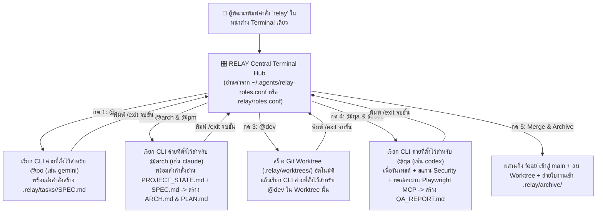

# เอกสารสถาปัตยกรรมระบบ (ARCH.md) — ขั้นตอนที่ 2 (`@arch`)
- **รหัสใบงาน:** `20261028-central-terminal-hub`
- **อ้างอิง:** `.relay/PROJECT_STATE.md` และ `SPEC.md`

## 1. สถาปัตยกรรมของ `RELAY Central Terminal Hub` (`relay.sh` & `relay.ps1`)



## 2. โครงสร้างไฟล์ตั้งค่าบทบาท (`relay-roles.conf`)
```ini
# ค่ายผู้ให้บริการที่รองรับ: claude | codex | gemini
ROLE_PO="gemini"
ROLE_ARCH="claude"
ROLE_DEV="claude"
ROLE_QA="codex"
```
- ลำดับการอ่านค่า (Configuration Precedence):
  1. อ่านค่าพื้นฐานจาก `~/.agents/relay-roles.conf`
  2. หากในโฟลเดอร์โครงการมีไฟล์ `.relay/roles.conf` จะนำค่าใน `.relay/roles.conf` มาทับเฉพาะโครงการนั้นทันที

## 3. การส่งคำสั่งเริ่มต้นเข้าสู่ Official CLI แบบ Interactive และการทดสอบความพร้อม (`relay test`)
- เพื่อให้การเรียกใช้งาน `claude`, `codex`, และ `gemini` เป็นแบบ **Interactive Session ในหน้าต่างเดิม (ปลอดภัยตามเงื่อนไขแพ็กเกจรายเดือน 100%)**:
  - ระบบจะแสดงกรอบข้อความสรุปคำสั่ง (Prompt) ของขั้นตอนนั้นบนหน้าจอ พร้อมคัดลอกคำสั่งเข้าสู่ Clipboard อัตโนมัติ (`pbcopy` บน macOS / `Set-Clipboard` บน Windows) และส่งเป็น Argument เริ่มต้นให้ CLI ทำให้ผู้ใช้เริ่มคุยต่อในหน้าต่างเดิมได้ทันทีโดยไม่ต้องพิมพ์คำสั่งยาวๆ เอง
- **สถาปัตยกรรมการทดสอบความพร้อมของตัวแทน AI (`run_agent_readiness_test` — เมนู `[t]` / `relay test`):**
  1. **ตรวจสอบทักษะประจำตำแหน่ง (Role Skill Pack Check):**
     - `@po`: `brainstorming`, `founder-skill`
     - `@arch/@pm`: `writing-plans`, `supabase-postgres-best-practices`
     - `@dev`: `impeccable`, `vercel-react-best-practices`, `lucide-icons`, `simple-icons`, `test-driven-development`, `systematic-debugging`
     - `@qa/@sec`: `verification-before-completion`, `differential-review`, `semgrep`, `playwright-qa`
  2. **ยิงคำสั่งทดสอบแบบ One-Shot ไปยัง CLI จริง (`ping_provider_agent`):**
     - `claude`: `claude [--model <model>] -p "<self-check-prompt>"`
     - `gemini`: `gemini [-m <model>] -p "<self-check-prompt>"`
     - `codex`: `codex [-m <model>] exec "<self-check-prompt>"`
     - ตัวแทน AI จะอ่านกฎและตอบกลับมารายงานชื่อบทบาท หน้าที่รับผิดชอบ และทักษะประจำตำแหน่งของตนเองเพื่อยืนยันความพร้อมใช้งาน 100%
