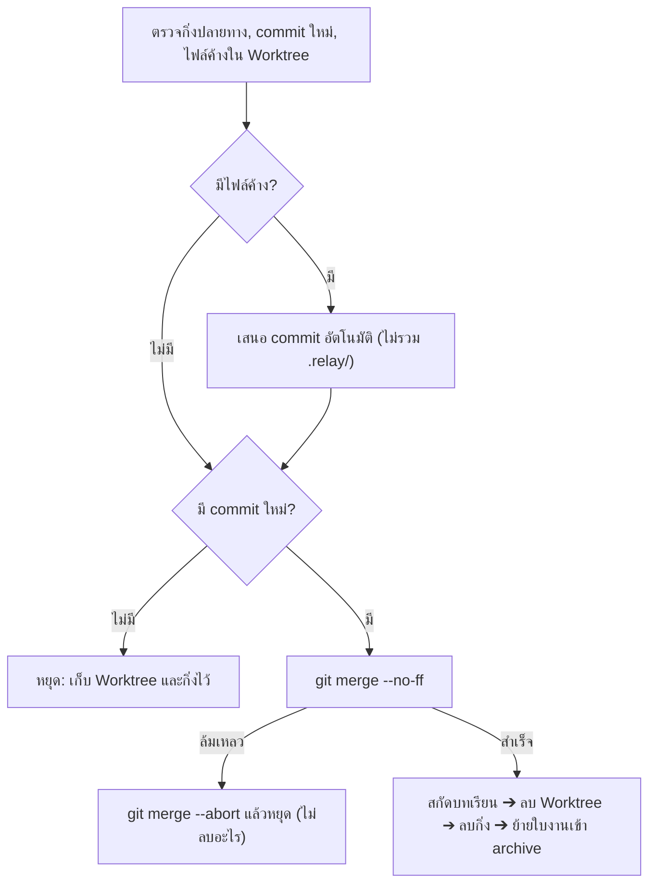

# ARCH — 20261029-safety-and-quota-countdown

## ฟังก์ชันใหม่ใน `relay.sh`
| ฟังก์ชัน | หน้าที่ |
| :-- | :-- |
| `ensure_relay_gitignore` | เพิ่ม `.relay/worktrees/` ลง `.gitignore` ของโปรเจกต์ถ้ายังไม่มี |
| `prepare_task_worktree` | สร้าง/ใช้ Worktree ของใบงาน, คัดลอก `.relay/` ที่จำเป็น, ตั้งค่า `TASK_WORK_DIR`; คืนค่า 1 พร้อมข้อความ error จริงเมื่อสร้างไม่ได้ (ใช้ร่วมกันทั้งขั้นตอนที่ 3 และ Auto-Loop) |
| `worktree_dirty_files` | รายการไฟล์ที่ยังไม่ commit ใน Worktree โดยไม่นับ `.relay/` (`git status --porcelain -- . ':(exclude).relay'`) |
| `run_with_timeout` | watchdog แบบ bash ล้วน (macOS ไม่มี `timeout`): รันคำสั่งเบื้องหลังด้วย stdin `/dev/null`, kill เมื่อเกินเวลา, คืนค่า 124 |
| `qa_verdict` | อ่าน `QA_REPORT.md` คืน `PASS` / `FAIL` / `NONE` (รองรับ markdown เช่น `**VERDICT: PASS**`) |
| `loop_halt` | บันทึก `[STOP]` ลง `LOOP_LOG.md` และแสดงกล่องเหตุผล |
| `format_countdown` / `effective_quota_pct` | นับถอยหลังจาก epoch, และคืน 100 เมื่อเลยเวลารีเซ็ต |
| `render_quota_table` | Python ตัวเดียวต่อการวาดหน้าจอ: คำนวณความกว้างตัวอักษรไทย (ไม่นับสระ/วรรณยุกต์ที่ซ้อน) เพื่อจัดคอลัมน์ให้ตรง |

## การเปลี่ยนแปลงข้อมูลแคช (`~/.agents/relay-quota.cache`)
- เพิ่ม 8 คีย์ `{AGY_GEMINI,AGY_CLAUDE,CODEX,CLAUDE}_{5H,7D}_RESET_EPOCH`
- คีย์เดิม `*_RESET` (ข้อความ) ยังคงอยู่เพื่อใช้แสดงเวลาจริงในวงเล็บ ➔ แคชเก่าใช้ต่อได้ (ไม่มี epoch ก็แสดงแบบเดิม)

## ลำดับขั้นตอนที่ 5 ใหม่

## โหมดสิทธิ์ของ Auto-Loop
- `agy --model M --mode auto -p ...` (ยืนยันจาก `agy --help`)
- `claude --model M --permission-mode acceptEdits -p ...`
- `codex exec --full-auto --skip-git-repo-check -m M ...`
