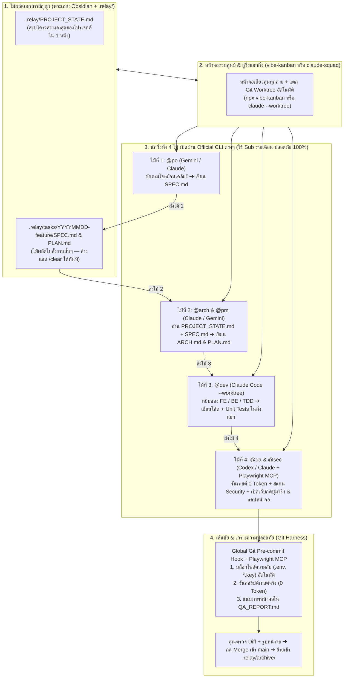

# 🏃‍♂️ RELAY (`.relay/`): ระบบส่งไม้ต่อระหว่าง AI หลายค่ายผ่านเอกสารสัญญา (v1.0 Community Edition)

**มาตรฐานการทำงานร่วมกับ AI (`Gemini` ➔ `Claude` ➔ `Codex`) แบบ "วิ่งผลัดส่งไม้ต่อ (Pass the Baton)"**  
*รองรับทั้ง **Windows** และ **macOS** • เริ่มต้นจาก 0 • ประหยัด Token 90% • ไม่ต้องสร้างเซิร์ฟเวอร์ครอบเอง • ไม่เสี่ยงโดนแบนแพ็กเกจรายเดือน (Subscription) 100%*

---

## 🌟 ทำไมถึงเกิดระบบ `RELAY` และมันช่วยคุณได้อย่างไร?

เมื่อเราสั่งงาน AI ในแชตเดียวไปนานๆ เราจะเจอ 3 ปัญหาใหญ่เสมอ:
1. **AI เริ่มมั่วและลืมคำสั่งแรก (Context Rot):** เพราะประวัติแชตยาวเกินไปจนข้อมูลเก่าตีกับข้อมูลใหม่
2. **โควตารายเดือนหมดไว (Token Explosion):** เพราะทุกครั้งที่พิมพ์ถาม 1 บรรทัด ระบบต้องส่งประวัติแชตเก่าทั้งหมดกลับไปคิดเงินใหม่ทุกเทิร์น
3. **เสี่ยงโดนแบนบัญชี (Ban Risk):** หากใช้โปรแกรมบอทเถื่อนแอบยิงคำสั่งอัตโนมัติรัวๆ หลังบ้านบนแพ็กเกจรายเดือน

### 💡 ทางออกของ `RELAY`: "วิ่งผลัด 4 ไม้ ส่งต่อด้วยใบสัญญาแผ่นเดียว"
แทนที่จะปล่อยให้ AI คุยกันเองในแชตยาวๆ ระบบ **`RELAY`** แบ่งการทำงานออกเป็น **4 ไม้ผลัด** โดยทุกครั้งที่คุยจบ 1 ไม้ เราจะกลั่นผลลัพธ์เป็นไฟล์สรุปสั้นๆ 1 หน้ากระดาษเก็บไว้ในโฟลเดอร์ **`.relay/`** (เปิดดูในแอป **Obsidian** ได้สวยงาม) แล้วพิมพ์ **`/clear` ล้างแชตทิ้งทันที!**

เมื่อ AI ไม้ถัดไปมารับงาน มันจะอ่านเฉพาะใบสั่งงานแผ่นเดียวที่คมกริบ ทำให้ **สมองโล่ง 100%, ประหยัด Token ลงถึง 90%, และเปิดใช้ผ่าน Official CLI ของแต่ละค่ายตรงๆ จึงปลอดภัยจากการโดนแบน 100%!**

---

## 🏛️ สถาปัตยกรรม 4 เสาหลักของ `RELAY`

| เสาหลักทั้ง 4 ส่วน | เครื่องมือที่ใช้จริง (ฟรี & Open-Source) | บทบาทหน้าที่ในระบบ |
| :--- | :--- | :--- |
| **1. ไม้ผลัดเอกสารสัญญา (พระเอก)** | **Obsidian** + โฟลเดอร์ **`.relay/`** + **[`github/spec-kit`](https://github.com/github/spec-kit)** | บังคับให้ **"ซักถามความต้องการให้จบก่อนลงมือทำ"** แล้วกลั่นเป็นไฟล์ `SPEC.md` และ `PLAN.md` หน้าเดียว ส่งไม้ต่อข้ามค่ายโดย Context ไม่เต็ม |
| **2. ทีมนักวิ่ง AI 3 ค่าย (ใช้ Sub เดิม)** | Official CLI: **`claude`**, **`codex`**, **`gemini`** + กฎ **`GLOBAL_AGENTS.md`** | เปิดใช้ CLI ของแต่ละเจ้าตรงๆ กำหนดบทบาท (`@po`, `@arch`, `@pm`, `@dev`, `@qa`, `@sec`) พร้อมผูก **ซองทักษะ (Skills)** เฉพาะสายงาน |
| **3. ลู่วิ่งแยกกิ่ง & หน้าจอคุมงาน** | **[`BloopAI/vibe-kanban`](https://github.com/BloopAI/vibe-kanban)** หรือ **[`smtg-ai/claude-squad`](https://github.com/smtg-ai/claude-squad)** + **`Git Worktree`** | แยกห้องทดลอง (`Git Worktree`) อัตโนมัติไม่ให้โค้ดหลัก (`main`) พัง และดู `git diff` ก่อนรวมโค้ดได้ในหน้าจอเดียว |
| **4. เกราะความปลอดภัย & ตาตรวจหน้าเว็บ** | **`Global Git Hook`** + **[`microsoft/playwright-mcp`](https://github.com/microsoft/playwright-mcp)** + **[`trailofbits/skills`](https://github.com/trailofbits/skills)** & **[`semgrep/skills`](https://github.com/semgrep/skills)** | ดักจับไฟล์ `.env` ไม่ให้หลุดด้วย `pre-commit hook`, รันสคริปต์เทสต์จริง (**0 Token**), สแกนช่องโหว่ความปลอดภัย และใช้ **Playwright MCP** เปิดเว็บกดปุ่ม/แคปหน้าจอตรวจงานฟรี 100% |



---

## 🐣 วิธีติดตั้งเริ่มตั้งแต่ 0 (Zero-to-Hero) รองรับทั้ง Windows และ macOS

> 📖 **หากเครื่องของคุณยังไม่มี Git หรือ Node.js เลย:** สามารถเปิดอ่านคู่มือจับมือทำแบบละเอียดทีละคลิกได้ที่ **[`docs/INSTALL_ZERO_TO_HERO.md`](./docs/INSTALL_ZERO_TO_HERO.md)**

### ขั้นที่ 1: ติดตั้งโปรแกรมพื้นฐาน (Git, Node.js, Obsidian) และตัว CLI ของค่าย AI

#### 🍎 สำหรับเครื่อง Mac (เปิดแอป `Terminal`)
```bash
# 1. ลง Git, Node.js, pnpm และ Obsidian (ผ่าน Homebrew)
brew install git node pnpm
brew install --cask obsidian

# 2. ลง Official CLI ของค่าย AI ที่คุณมีแพ็กเกจรายเดือน (มีค่ายไหนลงค่ายนั้น หรือลงครบทั้ง 3 ค่าย)
npm install -g @anthropic-ai/claude-code @openai/codex @google/gemini-cli
```

#### 🪟 สำหรับเครื่อง Windows (คลิกขวาเปิด `PowerShell` แบบ Run as Administrator)
```powershell
# 1. ลง Git, Node.js (LTS) และ Obsidian ผ่าน winget
winget install --id Git.Git -e --source winget
winget install --id OpenJS.NodeJS.LTS -e --source winget
winget install --id Obsidian.Obsidian -e --source winget
Set-ExecutionPolicy -ExecutionPolicy RemoteSigned -Scope CurrentUser -Force

# (ปิด PowerShell แล้วเปิดใหม่ 1 ครั้ง จากนั้นรันคำสั่งลง CLI ด้านล่าง)
npm install -g @anthropic-ai/claude-code @openai/codex @google/gemini-cli
```
*(หมายเหตุ: หลังลงเสร็จ ให้พิมพ์ `claude`, `codex`, หรือ `gemini` เพื่อ Login เข้าบัญชีรายเดือนของคุณ 1 ครั้ง)*

---

### ขั้นที่ 2: โคลน `RELAY` และติดตั้งสมองส่วนกลาง (ทำครั้งเดียว ใช้ได้ทุกโปรเจกต์ทั้งเครื่อง!)

คุณ **ไม่ต้องติดตั้งซ้ำทีละโปรเจกต์** เพราะสคริปต์ของ `RELAY` จะติดตั้งกฎกลางและคลังทักษะไว้ที่โฟลเดอร์ Home ของเครื่อง (`~/.agents/` บน Mac หรือ `%USERPROFILE%\.agents\` บน Windows) ทำให้ทุกโปรเจกต์ในเครื่องใช้งานได้ทันที!

#### 🍎 คำสั่งติดตั้งบน Mac / Linux:
```bash
git clone https://github.com/bosocmputer/RELAY.git
cd RELAY
chmod +x setup-mac.sh relay-skills.sh
./setup-mac.sh
./relay-skills.sh install
```

#### 🪟 คำสั่งติดตั้งบน Windows (PowerShell):
```powershell
git clone https://github.com/bosocmputer/RELAY.git
cd RELAY
.\setup-win.ps1
.\relay-skills.ps1 install
```

---

## 🧰 ระบบจัดการ อัปเดต และเพิ่ม Skills อัตโนมัติ (`relay-skills`)

เราคัดสรรสุดยอด Skills มาตรฐานระดับโลกมาให้ครบทั้ง 4 ไม้ในไฟล์ [`skills-manifest.txt`](./skills-manifest.txt) และคุณสามารถสั่ง **อัปเดตตามผู้พัฒนาต้นทาง** หรือ **เพิ่มสกิลใหม่** ได้ตลอดเวลา:

| คำสั่งใช้งาน | บน Mac / Linux (`Terminal`) | บน Windows (`PowerShell`) | หน้าที่การทำงาน |
| :--- | :--- | :--- | :--- |
| **1. ติดตั้งชุดมาตรฐาน** | `./relay-skills.sh install` | `.\relay-skills.ps1 install` | ติดตั้งชุด Skills ครบทั้ง 4 ไม้ + ผูก `Playwright MCP` |
| **2. อัปเดตเป็นเวอร์ชันล่าสุด** | `./relay-skills.sh update` | `.\relay-skills.ps1 update` | **ดึงอัปเดตเวอร์ชันใหม่ล่าสุด** จาก GitHub ของผู้พัฒนาต้นทางทุกตัวใน [`skills-manifest.txt`](./skills-manifest.txt) |
| **3. เพิ่ม Skill ใหม่เข้าคลัง** | `./relay-skills.sh add <repo_url> [skill]` | `.\relay-skills.ps1 add <repo_url> [skill]` | ติดตั้งสกิลใหม่เข้าเครื่อง **พร้อมบันทึกต่อท้ายลง `skills-manifest.txt` อัตโนมัติ** |
| **4. ดูรายการสกิลทั้งหมด** | `./relay-skills.sh list` | `.\relay-skills.ps1 list` | แสดงรายการสกิลทั้งหมดในคลังและที่ติดตั้งแล้วในเครื่อง |

### 📦 รายการซอง Skills มาตรฐานในชุด Base สายพัฒนาโปรแกรม (Software Engineering)
- **🏃‍♂️ ไม้ที่ 1 (`@po` — Product Owner):**
  - `brainstorming` ([`obra/superpowers`](https://github.com/obra/superpowers)) — ซักถามความต้องการทีละข้อจนเคลียร์ก่อนเริ่มทำ
  - `founder-skill` ([`Jakeschincariol/founder-skill`](https://github.com/Jakeschincariol/founder-skill)) — วิเคราะห์โมเดลธุรกิจและกลยุทธ์เมื่อขึ้นโปรเจกต์ใหม่
- **🏃‍♂️ ไม้ที่ 2 (`@arch & @pm` — Architect & Planner):**
  - `writing-plans` ([`obra/superpowers`](https://github.com/obra/superpowers)) — อ่าน `PROJECT_STATE.md` + `SPEC.md` แล้วแตกแผนเช็กลิสต์ลง `ARCH.md` & `PLAN.md`
- **🏃‍♂️ ไม้ที่ 3 (`@dev` — Full-Stack Developer แยก 3 ซองย่อย):**
  - **ซอง Frontend (UI/UX):** `impeccable` ([`pbakaus/impeccable`](https://github.com/pbakaus/impeccable)) + `vercel-react-best-practices` ([`vercel-labs/agent-skills`](https://github.com/vercel-labs/agent-skills)) + กฎการใช้ไอคอนจริงจาก `lucide-icons` / `simple-icons`
  - **ซอง Backend & Database:** `supabase-postgres-best-practices` ([`supabase/agent-skills`](https://github.com/supabase/agent-skills)) — มาตรฐานการออกแบบตาราง SQL, API, Auth และ RLS
  - **ซองวิศวกรรม & แก้บั๊ก:** `test-driven-development` + `systematic-debugging` ([`obra/superpowers`](https://github.com/obra/superpowers))
- **🏃‍♂️ ไม้ที่ 4 (`@qa & @sec` — Verifier & Security Auditor):**
  - `verification-before-completion` ([`obra/superpowers`](https://github.com/obra/superpowers)) — ห้ามบอกว่างานเสร็จจนกว่าเทสต์จะผ่านจริง
  - `differential-review` ([`trailofbits/skills`](https://github.com/trailofbits/skills)) & [`semgrep/skills`](https://github.com/semgrep/skills) — สแกนช่องโหว่ความปลอดภัย OWASP Top 10 เฉพาะจุดที่แก้ใน `git diff`
  - `playwright-qa` ([`microsoft/playwright-mcp`](https://github.com/microsoft/playwright-mcp)) — เปิดเบราว์เซอร์กดปุ่มทดสอบหน้าเว็บจริงและแคปหน้าจอฟรี 100%

---

## 🌍 การนำ `RELAY` ไปดัดแปลงใช้กับสายงานอื่นๆ (สร้างหนัง, วิดีโอ, บัญชี, ธุรกิจ)

นอกจากใช้สร้างและพัฒนาโปรแกรมแล้ว ระบบส่งไม้ต่อ 4 ไม้ของ `RELAY` ยังออกแบบให้ **ใครในสายอาชีพใดก็สามารถนำไปดัดแปลงใช้กับแผนกของตัวเองได้ทันที** เพียงแค่วางไฟล์ `AGENTS.md` ประจำสายงานนั้นลงในโฟลเดอร์งาน!

เราได้เตรียม **แม่แบบพร้อมใช้งาน (Domain Packs)** ไว้ให้ในโฟลเดอร์ **[`domains/`](./domains/)** ดังนี้:

| สายงาน | แม่แบบพร้อมใช้ใน Repo นี้ | บทบาททั้ง 4 ไม้ในสายงานนั้น |
| :--- | :--- | :--- |
| 💻 **1. สายพัฒนาซอฟต์แวร์ (Base หลัก)** | [`templates/GLOBAL_AGENTS.md`](./templates/GLOBAL_AGENTS.md) | `@po` (เก็บโจทย์) ➔ `@arch/@pm` (วางแผน) ➔ `@dev` (เขียนโค้ด FE/BE/TDD) ➔ `@qa/@sec` (เทสต์ + สแกนความปลอดภัย) |
| 🎬 **2. สายสร้างภาพยนตร์ วิดีโอ & ครีเอเตอร์** | [`domains/film-video-production/`](./domains/film-video-production/) | `@writer` (เขียนพล็อต `SPEC.md`) ➔ `@director` (แตก Shot List `PLAN.md`) ➔ `@creator` (เขียนบทพูด + Prompt ภาพ/วิดีโอ/เสียง) ➔ `@editor` (ตรวจความต่อเนื่อง & เวลา) |
| 📊 **3. สายบริษัท บัญชี & การเงิน** | [`domains/business-accounting/`](./domains/business-accounting/) | `@analyst` (เก็บเงื่อนไขภาษี `SPEC.md`) ➔ `@planner` (วางผังบัญชี/สูตร) ➔ `@operator` (ทำตาราง/สคริปต์คำนวณ) ➔ `@auditor` (รันสคริปต์ตรวจยอดดุล 0 Token) |

> 👉 อ่านวิธีสร้างสายงานใหม่ของคุณเองแบบละเอียดได้ที่ **[`docs/CUSTOM_DOMAINS_GUIDE.md`](./docs/CUSTOM_DOMAINS_GUIDE.md)**

---

## 🖥️ ทดสอบรัน 2 โปรเจกต์ตัวอย่างที่มีมาให้ใน Repo นี้ได้เลย!

ภายใน Repo นี้มีโปรเจกต์ตัวอย่างที่สร้างด้วยกระบวนการ `RELAY` ครบทั้ง 4 ไม้ พร้อมให้คุณเปิดดูและรันทดสอบทันที:

1. 📊 **`RELAY Board & Token Saver` ([`dashboard/index.html`](./dashboard/index.html)):**
   - หน้าเว็บ Dashboard แสดงกระดานวิ่งผลัด 4 ไม้ของใบงานจริง พร้อมเครื่องคำนวณเปรียบเทียบปริมาณ Token ที่ประหยัดได้เมื่อดูแลหลายโปรเจกต์
2. ☕ **`Mini Cafe POS + PromptPay QR` ([`examples/cafe-pos/`](./examples/cafe-pos/)):**
   - เว็บแอปคิดเงินร้านกาแฟ คำนวณภาษีมูลค่าเพิ่ม VAT 7% และสร้างหน้าต่างสแกนจ่าย PromptPay QR แบบล็อกยอดเงิน พร้อมชุด Unit Test ที่รันด้วยสคริปต์จริง (**0 Token**)

```bash
# ทดสอบรัน Unit Test ของระบบคิดเงินร้านกาแฟ (ใช้เวลา 0.1 วินาที และใช้ 0 Token!)
node --test examples/cafe-pos/pos-core.test.js

# เปิดดูหน้าเว็บตัวอย่างบน Mac:
open dashboard/index.html
open examples/cafe-pos/index.html

# เปิดดูหน้าเว็บตัวอย่างบน Windows (PowerShell):
start dashboard\index.html
start examples\cafe-pos\index.html
```

---

## 📚 สารบัญเอกสารเจาะลึกทั้งหมดในโปรเจกต์นี้

- 🐣 **[`docs/INSTALL_ZERO_TO_HERO.md`](./docs/INSTALL_ZERO_TO_HERO.md)** — คู่มือติดตั้งเริ่มตั้งแต่ 0 แบบจับมือทำสำหรับเครื่องเปล่า (ทั้ง Windows และ macOS)
- 🏛️ **[`docs/ARCHITECTURE_DEEP_DIVE.md`](./docs/ARCHITECTURE_DEEP_DIVE.md)** — เจาะลึกหลักการทำงาน สถาปัตยกรรม และการดูแลโปรเจกต์ระยะยาว 1 ปี+
- 🧰 **[`docs/SKILLS_AND_UPDATES.md`](./docs/SKILLS_AND_UPDATES.md)** — คู่มือการอัปเดต Skills ตามผู้พัฒนาต้นทาง การเพิ่มสกิลใหม่ และการเขียน `SKILL.md` ของตัวเอง
- 🌍 **[`docs/CUSTOM_DOMAINS_GUIDE.md`](./docs/CUSTOM_DOMAINS_GUIDE.md)** — คู่มือการดัดแปลง `RELAY` ไปใช้กับสายงานสร้างหนัง บัญชี การตลาด และสายอาชีพอื่นๆ
- 🤝 **[`CONTRIBUTING.md`](./CONTRIBUTING.md)** & **[`LICENSE`](./LICENSE)** — การมีส่วนร่วมของชุมชนภายใต้สัญญาอนุญาตเปิดเสรี MIT License
