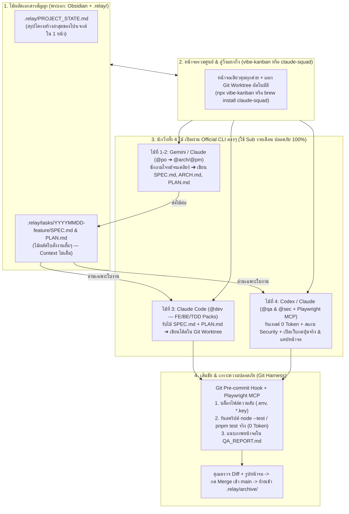

# 🏃‍♂️ RELAY (`.relay/`): Multi-CLI AI Coding Workflow & Starter Kit (v1.0)

**ระบบ "ส่งไม้ต่อ (Pass the Baton)" ระหว่าง AI (`Gemini` ➔ `Claude` ➔ `Codex`) ผ่านเอกสารสัญญาในโฟลเดอร์ `.relay/`**  
*ไม่ซับซ้อน • ไม่ต้องสร้างเซิร์ฟเวอร์ครอบเอง • ประหยัด Token 90% • ไม่เสี่ยงโดนแบนแพ็กเกจรายเดือน (Subscription) 100%*

---

## 📦 โครงสร้างในโปรเจกต์ `RELAY` นี้ (2-in-1: Starter Kit + Demo Sandbox)

Repo นี้ออกแบบให้ทำหน้าที่ 2 อย่างในที่เดียวสำหรับคุณและทีม:
1. **ชุดติดตั้งส่วนกลางของเครื่อง Mac (`setup-mac.sh` & `templates/`):** รันคำสั่งเดียวเพื่อตั้งค่ากฎกลาง `~/.agents/GLOBAL_AGENTS.md`, สกิลตรวจหน้าเว็บ `playwright-qa`, และเกราะป้องกันไฟล์ความลับ `pre-commit` ให้มีผลกับ **ทุกโปรเจกต์ (10+ โปรเจกต์) ในเครื่องทันที**
2. **โปรเจกต์ตัวอย่างพร้อมใช้งานจริง 2 ตัว (`dashboard/` & `examples/cafe-pos/`):**
   - 📊 **[`dashboard/index.html`](./dashboard/index.html) (`RELAY Board & Token Saver`):** หน้าแดชบอร์ดจำลองกระดานวิ่งผลัด 4 ไม้ อ่านเอกสารสัญญาจาก `.relay/` และคำนวณความคุ้มค่าของ Token ที่ประหยัดได้
   - ☕ **[`examples/cafe-pos/`](./examples/cafe-pos/) (`Mini Cafe POS + PromptPay QR`):** เว็บแอปคิดเงินร้านกาแฟ + คำนวณ VAT 7% + สร้าง QR พร้อมเพย์ พร้อมชุด Unit Test (`node --test`) ที่ใช้เวลา 0 Token สำหรับซ้อมวิ่งผลัดครบทั้ง 4 ไม้

```text
RELAY/
├── README.md                          # คู่มือหลักและ Master Blueprint ของระบบ RELAY
├── setup-mac.sh                       # สคริปต์ติดตั้งสมองส่วนกลาง (~/.agents/) และ Global Git Hook ในคำสั่งเดียว
├── templates/                         # แม่แบบไฟล์ตั้งค่าส่วนกลางประจำทีม
│   ├── GLOBAL_AGENTS.md               # กฎกลางเชื่อมไปยัง ~/.claude/CLAUDE.md, ~/.codex/AGENTS.md, ~/.gemini/GEMINI.md
│   ├── playwright-qa-SKILL.md         # สกิลสำหรับให้ @qa ใช้ Playwright MCP กดเทสต์หน้าเว็บจริง
│   ├── pre-commit                     # Global Git Hook ป้องกันการเผลอ Commit ไฟล์ .env / *.key / *.sqlite
│   └── install-skills.sh              # สคริปต์ดึงชุด Skills ครบทั้ง 4 ไม้ + ผูก Playwright MCP
├── .relay/                            # ไม้ผลัดเอกสารสัญญาของโปรเจกต์นี้ (เปิดดูด้วย Obsidian ได้เลย)
│   ├── PROJECT_STATE.md               # สรุปโครงสร้างล่าสุดของโปรเจกต์ (ไม่เกิน 2 หน้า)
│   ├── tasks/
│   │   └── 20261028-cafe-pos-promptpay/ # ตัวอย่างใบงานครบทั้ง 4 ไม้ (SPEC.md, ARCH.md, PLAN.md, QA_REPORT.md)
│   └── archive/                       # ที่เก็บใบงานเก่าที่ Merge เสร็จแล้ว
├── dashboard/
│   └── index.html                     # โปรเจกต์ตัวอย่างที่ 1: RELAY Board & Token Saver Dashboard
└── examples/
    └── cafe-pos/                      # โปรเจกต์ตัวอย่างที่ 2: Mini Cafe POS + PromptPay QR + Unit Tests (0 Token)
        ├── package.json
        ├── index.html
        ├── pos-core.js
        └── pos-core.test.js
```

---

## 🚀 วิธีติดตั้งเริ่มตั้งแต่ 0 บนเครื่อง Mac (ทำครั้งเดียว ใช้ได้ทั้ง 10+ โปรเจกต์)

### ขั้นที่ 1: โคลน Repo นี้และรันสคริปต์ตั้งค่าส่วนกลาง (`~/.agents/`)
```bash
git clone https://github.com/bosocmputer/RELAY.git
cd RELAY
chmod +x setup-mac.sh templates/install-skills.sh
./setup-mac.sh
```
*(คำสั่ง `./setup-mac.sh` จะสร้าง `~/.agents/GLOBAL_AGENTS.md`, เชื่อม Symlink ไปยัง `~/.claude/CLAUDE.md`, `~/.codex/AGENTS.md`, `~/.gemini/GEMINI.md` และเปิดใช้งาน Global Git `pre-commit` Hook ป้องกันไฟล์ `.env` หลุดในทุกโปรเจกต์ให้อัตโนมัติ)*

### ขั้นที่ 2: ติดตั้ง Official CLI ของค่าย AI และชุด Skills ประจำสายงาน
```bash
# 1. ลง CLI ของค่ายที่คุณมีแพ็กเกจรายเดือน (Pro / Max / Plus)
npm install -g @anthropic-ai/claude-code @openai/codex @google/gemini-cli

# 2. รันสคริปต์ดึงชุด Skills ทั้ง 4 ไม้ (FE, BE, TDD, Security) + ผูก Playwright MCP
./templates/install-skills.sh
```

### ขั้นที่ 3: ทดสอบรันโปรเจกต์ตัวอย่างใน Repo นี้ทันที!
```bash
# 1. ทดสอบรัน Unit Test ของระบบคิดเงินร้านกาแฟ (ใช้สคริปต์จริง 0 Token!)
node --test examples/cafe-pos/pos-core.test.js

# 2. เปิดหน้าเว็บ RELAY Dashboard และหน้าคิดเงิน Mini Cafe POS บนเบราว์เซอร์
open dashboard/index.html
open examples/cafe-pos/index.html
```

---

## 🏛️ สถาปัตยกรรม 4 เสาหลักของ `RELAY`

| เสาหลักทั้ง 4 ส่วน | เครื่องมือที่ใช้จริง (ไม่ต้องเขียนเอง) | บทบาทหน้าที่ |
| :--- | :--- | :--- |
| **1. ไม้ผลัดเอกสารสัญญา (พระเอก)** | **Obsidian** + โฟลเดอร์ **`.relay/`** + **[`github/spec-kit`](https://github.com/github/spec-kit)** | บังคับให้ **"ซักถามความต้องการให้จบก่อนลงมือทำ"** แล้วกลั่นเป็นไฟล์ `SPEC.md` และ `PLAN.md` หน้าเดียว ส่งไม้ต่อข้ามค่ายโดย Context ไม่เต็ม |
| **2. ทีมนักวิ่ง AI 3 ค่าย (ใช้ Sub ที่มีอยู่)** | Official CLI: **`claude`**, **`codex`**, **`gemini`** + ไฟล์กฎ **`AGENTS.md`** | เปิดใช้ CLI ของแต่ละเจ้าตรงๆ กำหนดบทบาท (`@po`, `@arch`, `@pm`, `@dev`, `@qa`, `@sec`) พร้อมผูก **Skills** เฉพาะสายงาน |
| **3. ลู่วิ่งแยกกิ่ง & ตาตรวจหน้าเว็บ (Harness & Browser)** | **[`BloopAI/vibe-kanban`](https://github.com/BloopAI/vibe-kanban)** หรือ **[`smtg-ai/claude-squad`](https://github.com/smtg-ai/claude-squad)** + **`Git Worktree`** + **`Git Hook`** + **[`microsoft/playwright-mcp`](https://github.com/microsoft/playwright-mcp)** | แยกห้องทดลอง (`Git Worktree`) อัตโนมัติ, ดักจับไฟล์ `.env` ไม่ให้หลุดด้วย `pre-commit hook`, รันสคริปต์เทสต์จริง (0 Token), และใช้ **Playwright MCP** เปิดเบราว์เซอร์กดปุ่ม/แคปหน้าจอตรวจงานฟรี 100% ด้วย Sub เดิม |
| **4. เลขาจดงานบนมือถือ (ตัวเลือกเสริม)** | **Hermes Agent (Telegram)** *(เปิดใช้เฉพาะคนอยากจดไอเดียนอกบ้าน)* | ใช้คุยปั้นไอเดียบนมือถือแล้วเซฟเป็นไฟล์ร่าง `SPEC.md` ลงโฟลเดอร์ `.relay/` รอไว้ **(ไม่สั่งรัน CLI รายเดือนอัตโนมัติหลังบ้านเพื่อกันโดนแบน)** |



---

## 🎽 ตารางบทบาททีมนักวิ่ง AI ทั้ง 4 ไม้ & ซอง Skills ประจำสายงาน

| ลำดับไม้ | บทบาท | ค่าย CLI ที่แนะนำ | ซอง Skills ที่ใช้ | ไม้ผลัดที่ส่งมอบ (Output) |
| :---: | :--- | :--- | :--- | :--- |
| **ไม้ 1** | **`@po` (Product Owner)** | `gemini` หรือ `claude` | `brainstorming`, `founder-skill` | `.relay/tasks/<id>/SPEC.md` |
| **ไม้ 2** | **`@arch` & `@pm` (Planner)** | `claude` หรือ `gemini` | `writing-plans` | `ARCH.md` & `PLAN.md` |
| **ไม้ 3** | **`@dev` (Full-Stack Developer)** | `claude --worktree` | **FE:** `impeccable`, `vercel-react-best-practices`, `lucide-icons`<br/>**BE:** `supabase-postgres-best-practices`<br/>**Core:** `test-driven-development`, `systematic-debugging` | โค้ดในกิ่งแยก + Unit Tests |
| **ไม้ 4** | **`@qa` & `@sec` (Verifier & Auditor)** | `codex` หรือ `claude` | `verification-before-completion`, `differential-review` (`trailofbits`), `semgrep/skills`, `playwright-qa` (`@playwright/mcp`) | `QA_REPORT.md` + รูปแคปหน้าจอ + อัปเดต `PROJECT_STATE.md` |

---

## 🛡️ การออกแบบเพื่อความยั่งยืนในระยะยาว (10+ โปรเจกต์ นาน 1 ปี+)

1. **ป้องกัน Context เต็มเมื่อใบงานสะสมเกิน 50 งาน:** ใช้ `.relay/PROJECT_STATE.md` (คุมความยาวไม่เกิน 2 หน้า) เก็บเฉพาะสถานะล่าสุดของโปรเจกต์ และย้ายใบงานที่ Merge แล้วเข้า `.relay/archive/` ทันที
2. **ป้องกันฮาร์ดดิสก์เครื่อง Mac เต็มจาก `Git Worktree`:** ใช้ `pnpm` เพื่อแชร์ไลบรารี `node_modules` จากศูนย์กลางของเครื่อง และลบ Worktree ทันทีเมื่อกด Merge เสร็จ
3. **ป้องกันเลขใบงานชนกันเมื่อทำหลายคนในทีม:** ใช้รหัสใบงานรูปแบบ `YYYYMMDD-slug` (เช่น `20261028-cafe-pos-promptpay`) แทนเลขรันนิ่ง `T-01`
4. **ย้ายเครื่อง Mac ใหม่ได้ในคำสั่งเดียว:** โคลน Repo `RELAY` นี้ไปรัน `./setup-mac.sh` และ `./templates/install-skills.sh` เครื่องใหม่จะพร้อมทำงานทันที!
