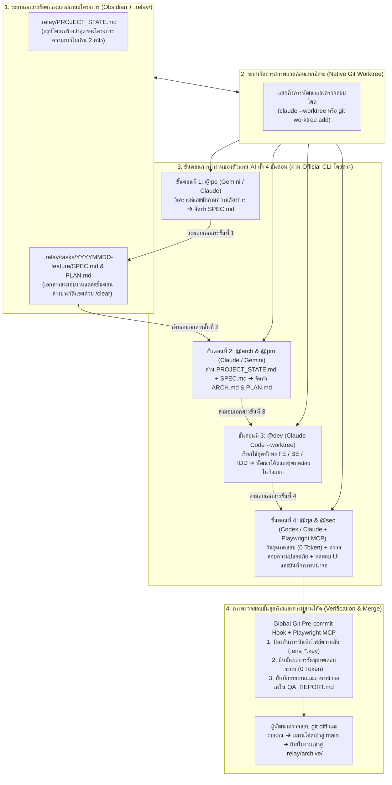

# RELAY (`.relay/`): มาตรฐานสถาปัตยกรรมการทำงานร่วมกับตัวแทน AI หลายค่ายผ่านเอกสารกำหนดข้อตกลง (v1.0 Official Edition)

**ระบบจัดการกระบวนการพัฒนาซอฟต์แวร์ร่วมกับตัวแทน AI (`Gemini` ➔ `Claude` ➔ `Codex`) แบบแบ่ง 4 ขั้นตอนผ่านเอกสารส่งมอบงาน**  
*รองรับทั้งระบบปฏิบัติการ **Windows** และ **macOS** • เริ่มต้นติดตั้งตั้งแต่ศูนย์ • ลดการใช้ Token 85–90% • ไม่ต้องดูแลเซิร์ฟเวอร์ตัวกลาง • ปลอดภัยตามเงื่อนไขการใช้งานแพ็กเกจรายเดือน (Subscription) 100%*

---

## 1. ที่มาและหลักการทำงานของระบบ `RELAY`

ในการพัฒนาซอฟต์แวร์ด้วยตัวแทน AI (AI Coding Agents) การสั่งงานต่อเนื่องในหน้าต่างสนทนาเดียวเป็นเวลานานมักก่อให้เกิดปัญหาสำคัญ 3 ประการ:
1. **ความคลาดเคลื่อนของผลลัพธ์เมื่อบริบทยาวเกินไป (Context Rot):** เมื่อประวัติการสนทนาสะสมมากขึ้น โมเดลภาษาจะเริ่มสับสนระหว่างข้อกำหนดเริ่มต้นกับการแก้ไขเฉพาะหน้า
2. **การสิ้นเปลืองโควตาการประมวลผล (Token Explosion):** ทุกข้อความใหม่ที่ส่งเข้าไปในหน้าต่างสนทนาเดิม ระบบจะต้องส่งประวัติการสนทนาทั้งหมดกลับไปประมวลผลซ้ำทุกครั้ง ทำให้โควตาของแพ็กเกจรายเดือนหมดลงอย่างรวดเร็ว
3. **ความเสี่ยงด้านการระงับบัญชี (Subscription Ban Risk):** การใช้สคริปต์อัตโนมัติครอบ CLI เพื่อยิงคำสั่งวนซ้ำเบื้องหลัง (Unattended Headless Loop) ขัดต่อข้อกำหนดการให้บริการของผู้ให้บริการ AI

### แนวทางแก้ไขของระบบ `RELAY` (4-Phase Artifact-Driven Workflow)
ระบบ **`RELAY`** แยกกระบวนการทำงานออกเป็น **4 ขั้นตอน (Phases)** โดยเมื่อสิ้นสุดแต่ละขั้นตอน ข้อมูลสำคัญจะถูกสกัดเป็นเอกสารข้อตกลงขนาดกะทัดรัดเก็บไว้ในโฟลเดอร์ **`.relay/`** (สามารถเปิดอ่านและจัดการผ่านโปรแกรม **Obsidian**) จากนั้นผู้พัฒนาจะใช้คำสั่ง **`/clear` เพื่อล้างหน่วยความจำการสนทนาทันที**

ตัวแทน AI ในขั้นตอนถัดไปจะอ่านเฉพาะเอกสารสรุปจากขั้นตอนก่อนหน้า ทำให้ได้รับบริบทที่ชัดเจนแม่นยำ ประหยัดโควตา Token ลงได้ถึง 85–90% และใช้งานผ่าน Official CLI ของผู้ให้บริการโดยตรงจึงปลอดภัยต่อบัญชีผู้ใช้งาน 100%

---

## 2. องค์ประกอบหลักทั้ง 4 ส่วนของสถาปัตยกรรม `RELAY`

| องค์ประกอบหลัก | เครื่องมือมาตรฐานที่ใช้ (Open-Source & Official Tools) | หน้าที่ความรับผิดชอบในระบบ |
| :--- | :--- | :--- |
| **1. ระบบจัดการเอกสารส่งมอบงานและสถานะโครงการ** | **Obsidian** + โฟลเดอร์ **`.relay/`** + **[`github/spec-kit`](https://github.com/github/spec-kit)** | จัดเก็บเอกสารสถานะโครงการ (`PROJECT_STATE.md`), เอกสารกำหนดความต้องการ (`SPEC.md`), แผนงาน (`ARCH.md`, `PLAN.md`) และรายงานผลการตรวจสอบ (`QA_REPORT.md`) |
| **2. บทบาทตัวแทน AI และชุดทักษะเฉพาะทาง** | Official CLI: **`claude`**, **`codex`**, **`gemini`** + ไฟล์กฎ **`GLOBAL_AGENTS.md`** | กำหนดบทบาทการทำงานทั้ง 4 ขั้นตอน (`@po`, `@arch`, `@pm`, `@dev`, `@qa`, `@sec`) พร้อมเชื่อมโยงชุดทักษะเฉพาะทาง (Modular Skill Packs) |
| **3. สภาพแวดล้อมการทำงานแยกอิสระ** | **`Git Worktree`** มาตรฐาน (`git worktree` / `claude --worktree`) | แยกกิ่งการพัฒนา (`Git Worktree`) ออกจากกิ่งหลัก (`main`) เพื่อป้องกันผลกระทบต่อโค้ดหลักและตรวจสอบ `git diff` ก่อนผสานโค้ด |
| **4. ระบบตรวจสอบความปลอดภัยและการทดสอบส่วนติดต่อผู้ใช้** | **`Global Git Hook`** + **[`microsoft/playwright-mcp`](https://github.com/microsoft/playwright-mcp)** + **[`trailofbits/skills`](https://github.com/trailofbits/skills)** & **[`semgrep/skills`](https://github.com/semgrep/skills)** | ป้องกันการบันทึกไฟล์ความลับ (`.env`) ด้วย `pre-commit hook`, รันชุดทดสอบระบบด้วยสคริปต์ (**0 Token**), สแกนช่องโหว่ความปลอดภัย และใช้ **Playwright MCP** ทดสอบส่วนติดต่อผู้ใช้บนเบราว์เซอร์จริงโดยไม่เสียค่าใช้จ่าย API เพิ่มเติม |



---

## 3. การติดตั้งระบบตั้งแต่เริ่มต้น (รองรับทั้ง Windows และ macOS)

> 📖 **สำหรับผู้เริ่มต้นที่ยังไม่มีเครื่องมือพื้นฐานในเครื่อง:** สามารถศึกษาขั้นตอนการติดตั้งแบบละเอียดทีละขั้นตอนได้ที่เอกสาร **[`docs/INSTALL_ZERO_TO_HERO.md`](./docs/INSTALL_ZERO_TO_HERO.md)**

### ขั้นตอนที่ 3.1: ติดตั้งโปรแกรมพื้นฐาน (Git, Node.js, Obsidian) และ Official CLI

#### 🍎 สำหรับระบบปฏิบัติการ macOS (รันใน `Terminal`)
```bash
# 1. ติดตั้ง Git, Node.js, pnpm และโปรแกรม Obsidian ผ่าน Homebrew
brew install git node pnpm
brew install --cask obsidian

# 2. ติดตั้ง Official CLI ของผู้ให้บริการที่คุณมีแพ็กเกจรายเดือน (เลือกค่ายที่ใช้งาน หรือติดตั้งทั้งหมด)
npm install -g @anthropic-ai/claude-code @openai/codex @google/gemini-cli
```

#### 🪟 สำหรับระบบปฏิบัติการ Windows (คลิกขวาเปิด `PowerShell` แบบ Run as Administrator)
```powershell
# 1. ติดตั้ง Git, Node.js (LTS) และโปรแกรม Obsidian ผ่าน winget
winget install --id Git.Git -e --source winget
winget install --id OpenJS.NodeJS.LTS -e --source winget
winget install --id Obsidian.Obsidian -e --source winget
Set-ExecutionPolicy -ExecutionPolicy RemoteSigned -Scope CurrentUser -Force

# 2. ปิดหน้าต่าง PowerShell แล้วเปิดใหม่ 1 ครั้ง จากนั้นติดตั้ง Official CLI
npm install -g @anthropic-ai/claude-code @openai/codex @google/gemini-cli
```
*(หลังจากติดตั้งเสร็จสิ้น ให้พิมพ์คำสั่ง `claude`, `codex` หรือ `gemini` เพื่อเข้าสู่ระบบตามสิทธิ์บัญชีรายเดือนของคุณ 1 ครั้ง)*

---

### ขั้นตอนที่ 3.2: ติดตั้งการตั้งค่าส่วนกลางของระบบ `RELAY` (ทำเพียงครั้งเดียว ใช้งานได้ทุกโครงการ)

สคริปต์ติดตั้งจะทำการสร้างโฟลเดอร์ส่วนกลาง (`~/.agents/` บน macOS หรือ `%USERPROFILE%\.agents\` บน Windows) เพื่อเก็บไฟล์กฎการทำงานส่วนกลาง ชุดทักษะทั้ง 4 ขั้นตอน สคริปต์เริ่มต้นโครงการ (`relay-init`) และกลไกตรวจสอบความปลอดภัยระดับ Global ทำให้ทุกโครงการในเครื่องพร้อมใช้งานทันทีโดยไม่ต้องติดตั้งซ้ำ

#### 🍎 คำสั่งติดตั้งบน macOS / Linux:
```bash
git clone https://github.com/bosocmputer/RELAY.git
cd RELAY
chmod +x setup-mac.sh relay-init.sh relay-skills.sh
./setup-mac.sh
./relay-skills.sh install
```

#### 🪟 คำสั่งติดตั้งบน Windows (PowerShell):
```powershell
git clone https://github.com/bosocmputer/RELAY.git
cd RELAY
.\setup-win.ps1
.\relay-skills.ps1 install
```

---

## 4. การติดตั้งและการใช้งานร่วมกับโปรแกรม Obsidian

### 4.1 จำเป็นต้องติดตั้งโปรแกรม Obsidian หรือไม่?
ไฟล์เอกสารทั้งหมดในโฟลเดอร์ `.relay/` เป็นไฟล์ Markdown มาตรฐาน (`.md`) ซึ่งสามารถเปิดอ่านและแก้ไขในโปรแกรมเขียนโค้ด (เช่น VS Code, Cursor หรือ Antigravity) ได้โดยตรง อย่างไรก็ตาม **เราแนะนำอย่างยิ่งให้ติดตั้งโปรแกรม Obsidian (ใช้งานฟรี 100%)** เพื่อใช้เป็น **"หน้าต่างจัดการเอกสารสัญญาและฐานความรู้ของโครงการ (Project Specification Hub)"** แยกต่างหากจากหน้าต่างเขียนโค้ด ช่วยให้อ่านแผนภาพสถาปัตยกรรม (Mermaid) ตรวจเช็กรายการงาน และดูภาพหน้าจอผลการทดสอบใน `QA_REPORT.md` ได้อย่างสะดวก

- **ลิงก์ดาวน์โหลดโดยตรง (กรณีไม่ติดตั้งผ่านคำสั่งข้างต้น):** [https://obsidian.md](https://obsidian.md)

### 4.2 วิธีเชื่อมต่อโฟลเดอร์ `.relay/` เข้ากับโปรแกรม Obsidian
1. เปิดโปรแกรม **Obsidian**
2. คลิกปุ่ม **"Open folder as vault"** (เปิดโฟลเดอร์เป็นคลังข้อมูล)
3. เลือกไปที่โฟลเดอร์ **`.relay`** ภายในโครงการของคุณ (เช่น `my-project/.relay`) แล้วกด **Open**
   *(คำแนะนำสำหรับผู้ใช้ macOS: หากไม่เห็นโฟลเดอร์ `.relay` ในหน้าต่างเลือกไฟล์ ให้กดปุ่มลัด `Command (⌘) + Shift + .` เพื่อแสดงโฟลเดอร์ที่ขึ้นต้นด้วยจุด)*
4. คุณจะสามารถเปิดดูและแก้ไขไฟล์ `PROJECT_STATE.md`, เอกสารในโฟลเดอร์ `tasks/` และประวัติงานใน `archive/` ได้แบบเรียลไทม์ควบคู่ไปกับการทำงานของ AI

---

## 5. วิธีการนำระบบ `RELAY` ไปใช้งานจริง (2 กรณีศึกษาหลัก)

> 📖 ศึกษารายละเอียดเชิงลึกและตัวอย่างชุดคำสั่งทั้งหมดเพิ่มเติมได้ที่ **[`docs/USE_CASES_NEW_AND_EXISTING.md`](./docs/USE_CASES_NEW_AND_EXISTING.md)**

### กรณีศึกษาที่ 1: การเริ่มต้นโครงการใหม่ตั้งแต่ศูนย์ (Greenfield Project — ติดตั้ง `RELAY` ก่อนเริ่มพัฒนาซอฟต์แวร์)

เมื่อคุณต้องการสร้างแอปพลิเคชันหรือระบบใหม่ตั้งแต่ศูนย์ ให้เตรียมโครงสร้าง `.relay/` ก่อนเริ่มเขียนโค้ดตามขั้นตอนดังนี้:

1. **สร้างโฟลเดอร์โครงการและเตรียมโครงสร้าง `.relay/`:**
   - **บน macOS / Linux:**
     ```bash
     mkdir my-new-app && cd my-new-app
     git init -b main
     ~/.agents/bin/relay-init . new
     ```
   - **บน Windows (PowerShell):**
     ```powershell
     mkdir my-new-app; cd my-new-app
     git init -b main
     & "$HOME\.agents\bin\relay-init.ps1" . new
     ```
   *(หรือสร้างด้วยคำสั่งพื้นฐาน: `mkdir -p .relay/tasks .relay/archive`)*

2. **เริ่มขั้นตอนที่ 1 (`@po` — กำหนดความต้องการของโครงการใหม่):**
   เปิดใช้งาน CLI (`gemini` หรือ `claude`) แล้วสั่งงาน:
   > `"@po ฉันต้องการสร้างโปรเจกต์ใหม่เกี่ยวกับ [ระบุรายละเอียดระบบ] ช่วยซักถามความต้องการและขอบเขตของระบบทีละประเด็นจนชัดเจน แล้วสรุปเป็นไฟล์ .relay/tasks/20261028-initial-system/SPEC.md"`
   เมื่อได้ไฟล์ `SPEC.md` ที่ถูกต้องแล้ว ให้พิมพ์ **`/clear`** เพื่อล้างประวัติการสนทนา

3. **ส่งมอบงานไปยังขั้นตอนที่ 2, 3 และ 4 ตามลำดับ:**
   - **ขั้นตอนที่ 2 (`@arch` & `@pm`):** สั่งให้อ่าน `SPEC.md` เพื่อสร้างแผนสถาปัตยกรรม `ARCH.md`, รายการดำเนินงาน `PLAN.md`, และบันทึกโครงสร้างตั้งต้นลงใน `.relay/PROJECT_STATE.md` จากนั้นพิมพ์ `/clear`
   - **ขั้นตอนที่ 3 (`@dev`):** เปิดสภาพแวดล้อมแยกอิสระ (`claude --worktree initial-system`) แล้วสั่งให้อ่าน `SPEC.md`, `ARCH.md` และ `PLAN.md` เพื่อพัฒนาโค้ดและชุดทดสอบ
   - **ขั้นตอนที่ 4 (`@qa` & `@sec`):** สั่งให้รันชุดทดสอบระบบ ตรวจสอบความปลอดภัยด้วย `differential-review` และทดสอบหน้าเว็บด้วย `Playwright MCP` พร้อมสรุปผลลงใน `QA_REPORT.md`

---

### กรณีศึกษาที่ 2: การนำ `RELAY` ไปใช้กับโครงการเดิมที่มีอยู่แล้ว (Brownfield / Existing Project)

หากคุณมีโครงการเดิมที่พัฒนามาอยู่แล้วโดยไม่เคยใช้ระบบ `RELAY` มาก่อน คุณสามารถนำ `RELAY` เข้าไปติดตั้งเพื่อจัดระเบียบการพัฒนาต่อได้ทันที โดยไม่ต้องรื้อโครงสร้างโค้ดเดิม:

1. **สร้างโครงสร้าง `.relay/` ในโฟลเดอร์โครงการเดิม:**
   - **บน macOS / Linux:**
     ```bash
     cd /path/to/existing-project
     ~/.agents/bin/relay-init . existing
     ```
   - **บน Windows (PowerShell):**
     ```powershell
     cd C:\path\to\existing-project
     & "$HOME\.agents\bin\relay-init.ps1" . existing
     ```

2. **สั่งให้ `@arch` สแกนโครงการเดิมเพื่อสร้างไฟล์ `.relay/PROJECT_STATE.md` (ดำเนินการเพียงครั้งเดียว):**
   เปิดใช้งาน CLI (`claude` หรือ `gemini`) ในโฟลเดอร์โครงการเดิม แล้วสั่งงานด้วยคำสั่งต่อไปนี้:
   > `"@arch ช่วยสำรวจและวิเคราะห์โครงสร้างของโครงการเดิมนี้ทั้งหมด (ประกอบด้วย Tech Stack, โครงสร้างโฟลเดอร์สำคัญ, รูปแบบฐานข้อมูล/Schema, รายการ API หลัก และคำสั่งที่ใช้ในการ Build/Test) แล้วสรุปเขียนทับลงในไฟล์ .relay/PROJECT_STATE.md ให้มีความชัดเจนและกระชับ (ความยาวไม่เกิน 2 หน้า) โดยห้ามแก้ไขไฟล์โค้ดใดๆ ของระบบ"`
   เมื่อได้ไฟล์ `.relay/PROJECT_STATE.md` แล้ว ให้พิมพ์ **`/clear`**

3. **เริ่มต้นพัฒนาฟีเจอร์ใหม่หรือแก้ไขข้อผิดพลาดตามขั้นตอนปกติ:**
   ตั้งแต่นี้เป็นต้นไป เมื่อต้องการเพิ่มฟีเจอร์หรือแก้ไขข้อผิดพลาดในโครงการเดิม ให้เริ่มที่ **ขั้นตอนที่ 1 (`@po`)** เพื่อสร้างใบงาน `.relay/tasks/YYYYMMDD-feature/SPEC.md` ➔ ส่งต่อให้ **ขั้นตอนที่ 2 (`@arch` & `@pm`)** ซึ่งจะอ่าน `.relay/PROJECT_STATE.md` คู่กับ `SPEC.md` ทำให้เข้าใจโครงสร้างโค้ดเดิมทันที ➔ พัฒนาในกิ่งแยกด้วย **ขั้นตอนที่ 3 (`@dev`)** ➔ และตรวจสอบด้วย **ขั้นตอนที่ 4 (`@qa` & `@sec`)**

---

## 6. ระบบจัดการ การอัปเดต และการเพิ่มชุดทักษะ (`relay-skills`)

ระบบ `RELAY` รวบรวมชุดทักษะมาตรฐานสำหรับงานวิศวกรรมซอฟต์แวร์ไว้ในไฟล์ [`skills-manifest.txt`](./skills-manifest.txt) และรองรับการดึงอัปเดตเวอร์ชันล่าสุดจากผู้พัฒนาต้นทางบน GitHub รวมถึงการเพิ่มทักษะใหม่เข้าสู่ระบบ:

| การดำเนินการ | คำสั่งบน macOS / Linux (`Terminal`) | คำสั่งบน Windows (`PowerShell`) | รายละเอียดการทำงาน |
| :--- | :--- | :--- | :--- |
| **1. ติดตั้งชุดทักษะมาตรฐาน** | `./relay-skills.sh install` | `.\relay-skills.ps1 install` | ติดตั้งชุดทักษะทั้ง 4 ขั้นตอนและเชื่อมต่อ `Playwright MCP` |
| **2. อัปเดตทักษะเป็นเวอร์ชันล่าสุด** | `./relay-skills.sh update` | `.\relay-skills.ps1 update` | ดึงข้อมูลอัปเดตเวอร์ชันล่าสุดจากคลังโค้ดของผู้พัฒนาต้นทางทุกตัวใน [`skills-manifest.txt`](./skills-manifest.txt) |
| **3. เพิ่มทักษะใหม่เข้าสู่คลัง** | `./relay-skills.sh add <repo_url> [skill]` | `.\relay-skills.ps1 add <repo_url> [skill]` | ติดตั้งทักษะใหม่ลงเครื่องและบันทึกต่อท้ายลงใน `skills-manifest.txt` อัตโนมัติ |
| **4. แสดงรายการทักษะทั้งหมด** | `./relay-skills.sh list` | `.\relay-skills.ps1 list` | แสดงรายการทักษะในคลังและที่ติดตั้งอยู่ในเครื่อง |

---

## 7. การประยุกต์ใช้ระบบ `RELAY` กับสายงานอื่น (`domains/`)

นอกเหนือจากสายงานวิศวกรรมซอฟต์แวร์ซึ่งเป็นค่าเริ่มต้นของระบบแล้ว โครงสร้างการทำงาน 4 ขั้นตอนของ `RELAY` ยังสามารถนำไปประยุกต์ใช้กับสายงานอื่นๆ ได้โดยการวางไฟล์ `AGENTS.md` เฉพาะสายงานลงในโฟลเดอร์โครงการ:

| สายงาน | แม่แบบในคลังโค้ดนี้ | ลำดับบทบาททั้ง 4 ขั้นตอน |
| :--- | :--- | :--- |
| 💻 **1. สายงานวิศวกรรมซอฟต์แวร์ (ค่าเริ่มต้น)** | [`templates/GLOBAL_AGENTS.md`](./templates/GLOBAL_AGENTS.md) | `@po` (วิเคราะห์ความต้องการ) ➔ `@arch/@pm` (ออกแบบและวางแผน) ➔ `@dev` (พัฒนาโค้ดและชุดทดสอบ) ➔ `@qa/@sec` (ตรวจสอบคุณภาพและความปลอดภัย) |
| 🎬 **2. สายงานผลิตภาพยนตร์ วิดีโอ และสื่อสร้างสรรค์** | [`domains/film-video-production/`](./domains/film-video-production/) | `@writer` (พัฒนาโครงเรื่อง `SPEC.md`) ➔ `@director` (ออกแบบลำดับภาพ `PLAN.md`) ➔ `@creator` (เขียนบทและคำสั่งสร้างภาพ/วิดีโอ/เสียง) ➔ `@editor` (ตรวจสอบความต่อเนื่องและเวลา) |
| 📊 **3. สายงานบริหารธุรกิจ บัญชี และการเงิน** | [`domains/business-accounting/`](./domains/business-accounting/) | `@analyst` (กำหนดเงื่อนไขธุรกิจและภาษี `SPEC.md`) ➔ `@planner` (ออกแบบผังบัญชีและสูตรคำนวณ) ➔ `@operator` (จัดทำตารางและสคริปต์ประมวลผล) ➔ `@auditor` (รันสคริปต์ตรวจสอบความถูกต้องของตัวเลข) |

---

## 8. สารบัญเอกสารคู่มือเชิงลึก

- 🐣 **[`docs/INSTALL_ZERO_TO_HERO.md`](./docs/INSTALL_ZERO_TO_HERO.md)** — คู่มือการติดตั้งตั้งแต่เริ่มต้นสำหรับ Windows และ macOS และการเชื่อมต่อโปรแกรม Obsidian
- 📘 **[`docs/USE_CASES_NEW_AND_EXISTING.md`](./docs/USE_CASES_NEW_AND_EXISTING.md)** — คู่มือการนำ `RELAY` ไปใช้กับโครงการใหม่ (Greenfield) และโครงการเดิม (Brownfield)
- 🏛️ **[`docs/ARCHITECTURE_DEEP_DIVE.md`](./docs/ARCHITECTURE_DEEP_DIVE.md)** — รายละเอียดสถาปัตยกรรม หลักการทำงาน และการจัดการโครงการระยะยาว
- 🧰 **[`docs/SKILLS_AND_UPDATES.md`](./docs/SKILLS_AND_UPDATES.md)** — คู่มือการอัปเดตทักษะ การเพิ่มทักษะใหม่ และการสร้างไฟล์ `SKILL.md` เฉพาะองค์กร
- 🌍 **[`docs/CUSTOM_DOMAINS_GUIDE.md`](./docs/CUSTOM_DOMAINS_GUIDE.md)** — คู่มือการประยุกต์ใช้ `RELAY` กับสายงานอื่นนอกเหนือจากงานพัฒนาซอฟต์แวร์
- 🤝 **[`CONTRIBUTING.md`](./CONTRIBUTING.md)** และ **[`LICENSE`](./LICENSE)** — แนวทางการมีส่วนร่วมพัฒนาภายใต้สัญญาอนุญาต MIT License
