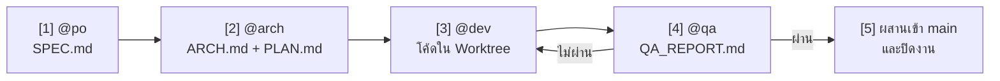

# RELAY — ทีม AI ส่งไม้ต่อกัน

**RELAY คือหน้าจอใน Terminal ที่ช่วยให้คุณสั่ง AI หลายตัว (`claude`, `codex`, `agy`) ทำงานเขียนโปรแกรมเป็นทีม แบ่งหน้าที่ชัดเจน และส่งงานต่อกันด้วยเอกสารสั้นๆ แทนการคุยยาวในหน้าต่างเดียว**

- ใช้ได้เต็มรูปแบบบน **macOS / Linux** • Windows รองรับบางส่วน (ดูหัวข้อ [ข้อจำกัด](#10-ข้อจำกัดที่ควรรู้ก่อนใช้))
- เรียกเฉพาะ CLI ทางการของแต่ละค่ายผ่านบัญชีของคุณเอง — RELAY ไม่ดึง ไม่เก็บ และไม่แชร์ token การเข้าสู่ระบบ
- งานที่ AI ทำใช้ **โควต้าแพ็กเกจของคุณ** ตามปกติ

---

## 1. RELAY ช่วยอะไร

ถ้าเคยสั่ง AI เขียนโค้ดในหน้าต่างเดียวนานๆ จะเจอปัญหาเหล่านี้:

| ปัญหา | RELAY ช่วยอย่างไร |
| :-- | :-- |
| คุยยาวแล้ว AI เริ่มลืมสิ่งที่ตกลงกันไว้ตอนแรก | แบ่งงานเป็นขั้นตอน แต่ละขั้นเริ่มใหม่และอ่านแค่เอกสารสรุปของขั้นก่อน |
| โควต้าหมดเร็ว เพราะทุกข้อความต้องส่งประวัติทั้งหมดซ้ำ | ส่งต่อด้วยไฟล์สั้นๆ (`SPEC.md`, `PLAN.md`, `QA_REPORT.md`) แทนประวัติแชท |
| ต้องสลับหน้าต่าง CLI หลายค่ายเอง และคัดลอกข้อความไปมา | เลือกได้ว่าแต่ละตำแหน่งใช้ค่ายไหน แล้วสั่งจากหน้าจอเดียว |
| AI แก้โค้ดบนกิ่งหลักตรงๆ จนพังทั้งโปรเจกต์ | ให้ `@dev` ทำงานใน Git Worktree แยก แล้วค่อยผสานเมื่อตรวจผ่าน |

### ทีม AI 4 ตำแหน่ง

| ตำแหน่ง | หน้าที่ | ผลงานที่ส่งต่อ |
| :-- | :-- | :-- |
| `@po` | คุยกับคุณเพื่อสรุปว่าต้องการอะไร และเกณฑ์ตรวจรับ | `SPEC.md` |
| `@arch` / `@pm` | ออกแบบและแบ่งขั้นตอนการทำ | `ARCH.md`, `PLAN.md` |
| `@dev` | เขียนโค้ดและเทสต์ในกิ่งแยก (Git Worktree) | โค้ด + commit |
| `@qa` / `@sec` | รันเทสต์ ตรวจความปลอดภัย สรุปผ่าน/ไม่ผ่าน | `QA_REPORT.md`, `QA_VERDICT.json` |

แต่ละตำแหน่งเลือกค่ายและโมเดลได้อิสระ เช่น ให้ `@dev` ใช้ `claude` แล้วให้ `@qa` ใช้ `codex` เพื่อให้คนละค่ายตรวจงานกัน **คุณภาพโค้ด (ทุกภาษา):** `@dev` ได้รับคำสั่งให้อ่านโค้ดเดิมและยึดแบบแผนของโปรเจกต์ ค้นฟังก์ชันหรือคอมโพเนนต์เดิมมาใช้ซ้ำก่อนสร้างใหม่ ห้ามคัดลอกโค้ดมาแก้ และไม่สร้าง abstraction เผื่ออนาคต ส่วน `@qa` ตรวจ diff เรื่องนี้ ถ้าเห็นโค้ดซ้ำหรือผิดแบบแผนชัดเจนจะให้ FAIL พร้อม `file:line` ทั้งหมดนี้เป็นคำสั่งให้ AI ระบบบังคับไม่ได้ ถ้าโปรเจกต์มีแบบแผนเฉพาะ ให้เขียนไว้ใน `AGENTS.md` ของโปรเจกต์ และตั้ง lint ให้ตรวจสิ่งที่ตรวจด้วยสคริปต์ได้

เอกสารทั้งหมดเก็บในโฟลเดอร์ `.relay/` ของโปรเจกต์นั้น เป็นไฟล์ `.md` / `.json` ธรรมดาที่เปิดด้วยโปรแกรมไหนก็ได้



---

## 2. หน้าตาของโปรแกรม

พิมพ์ `relay` แล้วจะเห็นหน้าจอแบบนี้ (ตัวอย่างจากเครื่องทดสอบ ตัวเลขโควต้าของคุณจะต่างไป):

```text
╭──────────────────────────────── RELAY v1.0.0 ─────────────────────────────────────────────────────────────────────╮
│                                 ตำแหน่ง AI                                                                         │
│     ▐█████▄                     @po:       agy (gemini-4-argon-high)  ● พร้อมใช้                                    │
│     ▐█    ▐█   ━━━▶             @arch/pm:  agy (claude-opus-5-5-high)  ● พร้อมใช้                                   │
│     ▐█████▀     ━━▶             @dev:      agy (claude-sonnet-5-5-high)  ● พร้อมใช้                                 │
│     ▐█   ▀█▄     ━▶             @qa/sec:   codex (gpt-6.1-terra)  ● พร้อมใช้                                        │
│     ▐█     ▀█▄                                                                                                    │
│                                 โควต้า (5 ชม. / 7 วัน)  อัปเดต 10:15:02 (เมื่อสักครู่) • กด [u] ดึงข้อมูลสด                  │
│      R E L A Y                  ค่าย / กระเป๋า      รอบ 5 ชม.                   รอบ 7 วัน                            │
│    ทีม AI ส่งไม้ต่อกัน               agy (Gemini)      ● 81%  อีก 1ชม.26น. (11:42)  ▲ 49%  อีก 1วัน 12ชม. (02 พ.ย. 00:10) │
│                                 agy (Claude/GPT)  ● 100%                      ● 99%                               │
│            โปรเจกต์              codex (Plus)      ● 70%  อีก 1ชม.17น. (11:33)  ● 61%                               │
│       my-project (main)         claude (Pro)      ▲ 35%                       ▲ 13%                               │
│     ~/Projects/my-project                                                                                         │
│                                 ความคืบหน้าและสถิติ                                                                   │
│            งานปัจจุบัน             เอกสาร:    ● SPEC  ● ARCH  ● PLAN  ○ QA  ·  ● PROJECT_STATE.md  ·  ○ กฎ 0 ข้อ      │
│       20261031-user-auth        สถิติ:     ยังไม่มีการรัน AI ในงานนี้ · กด [v] ดูสถิติ                                       │
│                                 ถัดไป:     [3] @dev เขียนโค้ดใน Git Worktree หรือ [a] ลูปอัตโนมัติ (3⇄4)                  │
│      เปลี่ยนโปรเจกต์: กด [f]                                                                                         │
╰───────────────────────────────────────────────────────────────────────────────────────────────────────────────────╯

  ขั้นตอนการทำงาน (↑/↓ เลือก • Enter รัน • หรือกดปุ่ม)
    [1] @po            เขียนความต้องการ (SPEC.md) · agy/gemini-4-argon-high
    [2] @arch & @pm    ออกแบบและวางแผน (ARCH.md, PLAN.md) · agy/claude-opus-5-5-high
  ❯ [3] @dev           เขียนโค้ด + เทสต์ใน Git Worktree · agy/claude-sonnet-5-5-high
    [4] @qa & @sec     ตรวจเทสต์ ความปลอดภัย (QA_REPORT.md) · codex/gpt-6.1-terra
    [5] ผสานโค้ด        ผสานกิ่งเข้า main และปิดงาน
    [a] ลูปอัตโนมัติ      รันขั้น 2 → 3 ⇄ 4 ให้อัตโนมัติ (/loop)
    [x] งานด่วน         ข้าม @po / @arch ให้ @dev แก้ใน Worktree (/fast)

  ปุ่มลัด
  [c] โมเดล    [g] ตำแหน่ง   [u] โควต้า   [v] สถิติ    [l] กฎ
  [n] งานใหม่   [f] โปรเจกต์  [t] ทดสอบ   [d] Login    [s] Skills  [q] ออก
```

- **ซ้าย:** โปรเจกต์ที่เลือกอยู่และงานปัจจุบัน (ถ้ายังไม่ได้เลือกจะขึ้น `▲ ยังไม่ได้เลือกโปรเจกต์`)
- **ขวา:** แต่ละตำแหน่งใช้ AI ตัวไหน, โควต้าที่เหลือ (ค่าจากแคช กด `[u]` เพื่อดึงใหม่) และขั้นตอนถัดไปที่แนะนำ
- ตัวชี้ `❯` จะเลื่อนไปที่ขั้นตอนที่ควรทำต่อให้เอง

---

## 3. สิ่งที่ต้องมีก่อนติดตั้ง

| สิ่งที่ต้องมี | หมายเหตุ |
| :-- | :-- |
| macOS หรือ Linux | Windows ดูหัวข้อ [ข้อจำกัด](#10-ข้อจำกัดที่ควรรู้ก่อนใช้) |
| `git`, `bash`, `python3` | macOS มี `bash` และ `python3` มาให้ (หรือติดตั้งผ่าน Homebrew) |
| Node.js + npm | ใช้ติดตั้ง CLI ของ AI และชุดทักษะ |
| **AI CLI อย่างน้อย 1 ค่าย พร้อมบัญชีที่ใช้งานได้** | `claude` (Claude Code), `codex` (OpenAI Codex CLI) หรือ `agy` (Antigravity CLI ของ Google AI Ultra อยู่ที่ `~/.gemini/bin/agy`) |

> ยังไม่มีเครื่องมือพื้นฐานเลย? ดูคู่มือทีละขั้นที่ [`docs/INSTALL_ZERO_TO_HERO.md`](./docs/INSTALL_ZERO_TO_HERO.md)

---

## 4. ติดตั้ง (macOS / Linux)

**ขั้นที่ 1 — ติดตั้งเครื่องมือพื้นฐานและ AI CLI** (ข้ามตัวที่มีแล้วได้)

```bash
brew install git node
```

```bash
npm install -g @anthropic-ai/claude-code @openai/codex
```

**ขั้นที่ 2 — ดาวน์โหลดและติดตั้ง RELAY**

```bash
git clone https://github.com/bosocmputer/RELAY.git && cd RELAY && ./setup-mac.sh
```

**ขั้นที่ 3 — โหลด PATH ใหม่ แล้วติดตั้งชุดทักษะมาตรฐาน**

```bash
source ~/.zshrc && ./relay-skills.sh install
```

เสร็จแล้วพิมพ์ `relay` ได้จากทุกโฟลเดอร์ (ถ้าพิมพ์แล้วไม่เจอคำสั่ง ให้ปิด Terminal แล้วเปิดใหม่)

> **ติดตั้งแล้ว RELAY แก้อะไรในเครื่องบ้าง?** ดูรายการทั้งหมดที่หัวข้อ [8](#8-สิ่งที่-relay-ติดตั้งและแก้ในเครื่องคุณ)

---

## 5. ใช้งานครั้งแรก ทีละขั้น

RELAY จะพาไปทีละขั้นเอง หน้าจอบอกเสมอว่าตอนนี้อยู่ขั้นไหน

1. **เปิดโปรแกรม** — พิมพ์ `relay`
2. **ขั้นที่ 1/3: ตั้งค่า AI** — เลือกว่าแต่ละตำแหน่งจะใช้ค่ายและโมเดลไหน
   - `[1]` ตั้งค่าด่วน (ชุดแนะนำ) หรือ `[2]` เลือกเองทีละตำแหน่ง
   - ถ้ายังไม่ได้ Login ค่ายไหน ใช้ `[3]` เพื่อเข้าสู่ระบบ
   - ขั้นนี้ผ่านเมื่อครบ 4 ตำแหน่ง (หน้าจอบอก `พร้อมใช้งานจริง x/4`)
3. **ขั้นที่ 2/3: เลือกโปรเจกต์** — ถ้าเปิด `relay` จากโฟลเดอร์ Home ให้กด `[1]` เพื่อเลือกโฟลเดอร์ในเครื่องหรือสร้างใหม่ (หรือ `cd` เข้าโฟลเดอร์โปรเจกต์ก่อนพิมพ์ `relay`) จากนั้นเลือกแบบใดแบบหนึ่ง
   - `[1]` **โปรเจกต์ใหม่** — สร้างโฟลเดอร์ `.relay/` ให้ทันที
   - `[2]` **โปรเจกต์เดิมที่มีโค้ดแล้ว** — ให้ `@arch` อ่านโค้ดเดิมแล้วสรุปเป็น `.relay/PROJECT_STATE.md` (ใช้ AI หนึ่งรอบ)
4. **ขั้นที่ 3/3: สั่งงาน**
   - กด `[1]` คุยกับ `@po` บอกสิ่งที่อยากได้ จนได้ `SPEC.md`
   - เมื่อ AI ทำงานของขั้นนั้นเสร็จ จะบอกให้พิมพ์ `/exit` เพื่อกลับมาที่ RELAY แล้ว RELAY จะเสนอขั้นถัดไปให้เลือกทันที (เช่น ได้ `SPEC.md` แล้ว ➔ `[2]` หรือ `[a]`) ไม่ต้องกลับหน้าหลักไปเลือกเอง
   - ทำต่อทีละขั้น `[2]` → `[3]` → `[4]` หรือกด `[a]` ให้ทำต่อเองอัตโนมัติ
5. **ปิดงาน** — เมื่อ `@qa` ตรวจผ่าน กด `[5]` เพื่อผสานโค้ดเข้ากิ่งหลักและเก็บใบงานเข้า `.relay/archive/`

**ต้องสร้าง git repo เองก่อนไหม?** ไม่ต้อง และไม่ต้องมี repo บน GitHub (RELAY ไม่ push ให้) — ตอนเริ่ม `[3]` หรือ `[x]` ครั้งแรก RELAY จะ `git init` และสร้าง commit แรกให้เอง สิ่งที่ต้องมีคือ `git config user.name` / `user.email`
- **โปรเจกต์เดิมที่ยังไม่มี git:** RELAY จะแสดงจำนวนไฟล์และถามก่อน commit ไฟล์เดิมเป็น commit แรก (ไม่รวม `.relay/` และไฟล์ความลับ) เพราะ `@dev` ทำงานใน Worktree ที่แยกจาก commit — ตรวจ `.gitignore` ก่อนตอบ เช่น ให้มี `node_modules/`
- **โปรเจกต์เดิมที่เป็น git อยู่แล้ว:** commit งานที่ค้างก่อน เพราะไฟล์ที่ยังไม่ commit จะไม่อยู่ใน Worktree และ `[5]` จะหยุดถ้ากิ่งหลักมีไฟล์ที่แก้ค้าง

อยากเปลี่ยนโปรเจกต์เมื่อไรก็กด `[f]` • ทุกเมนูกด `b` หรือ `ESC` เพื่อย้อนกลับได้

> ตัวอย่างการใช้งานกับโปรเจกต์ใหม่และโปรเจกต์เดิมแบบละเอียด: [`docs/USE_CASES_NEW_AND_EXISTING.md`](./docs/USE_CASES_NEW_AND_EXISTING.md)

---

## 6. ปุ่มที่ใช้บ่อย

| ปุ่ม | ทำอะไร | สั่งตรงจาก Terminal |
| :-- | :-- | :-- |
| `1`–`5` | รันขั้นตอนที่ 1–5 ของใบงาน | `relay 1` … `relay 5` |
| `a` | ลูปอัตโนมัติ (ขั้น 2 → 3 ⇄ 4) | `relay loop` |
| `x` | งานด่วน: ข้าม `@po` / `@arch` ให้ `@dev` แก้เลย | `relay fast` |
| `n` | เริ่มใบงานใหม่ | — |
| `f` | เลือก / เปลี่ยนโปรเจกต์ | — |
| `c` | เปลี่ยนค่ายและโมเดลของแต่ละตำแหน่ง | `relay config` |
| `g` | แก้คำสั่ง Prompt ทักษะ หรือเพิ่มตำแหน่งใหม่ (เช่น `@ux`) | `relay agents` |
| `u` | ดึงโควต้าล่าสุดของทุกค่าย | `relay quota` |
| `v` | ดูเวลาและจำนวน Token แยกตามขั้นตอนและโมเดล | `relay stats` |
| `l` | ทบทวนและอนุมัติกฎที่ระบบเสนอจากงานที่ผ่านมา | `relay learn` |
| `t` | ทดสอบว่า CLI แต่ละตำแหน่งตอบกลับได้ | `relay test` |
| `d` | จัดการการติดตั้ง CLI และการ Login | `relay connect` |
| `s` | ติดตั้ง / อัปเดต / เพิ่มชุดทักษะ (Skills) | `relay-skills` |
| `q` | ออก | — |

> `[t]` ทดสอบเฉพาะว่า CLI รับคำสั่งและตอบกลับได้ ยังไม่ใช่การทดสอบว่า AI ทำงานได้ถูกต้อง

---

## 7. เลือกโหมดทำงานให้เหมาะกับงาน

| โหมด | เหมาะกับ | วิธีใช้ |
| :-- | :-- | :-- |
| **ทีละขั้น** | งานใหม่ที่อยากดูและตัดสินใจเองทุกขั้น | `[1]` → `[2]` → `[3]` → `[4]` → `[5]` |
| **งานด่วน** | แก้บั๊กหรืองานเล็ก ไม่คุ้มเขียนเอกสารครบ | `[x]` → ตรวจผล → `[5]` (ผลตรวจที่ `@dev` เขียนเองแสดงเป็น `▲ QA PASS (self)` แนะนำกด `[4]` ให้ `@qa` ตรวจอีกรอบก่อนผสาน) |
| **ลูปอัตโนมัติ** | งานที่มี `SPEC.md` ชัดเจนแล้ว อยากให้ทำต่อเอง | `[1]` → `[a]` → `[5]` |

**ลูปอัตโนมัติมีเบรกกันพลาดดังนี้:**
- `@qa` ตรวจไม่ผ่าน → ส่งกลับให้ `@dev` แก้ได้ **สูงสุด 3 รอบ** แล้วหยุด
- แต่ละขั้นทำงานนานเกิน **30 นาที** → หยุด (ปรับได้ด้วย `RELAY_STEP_TIMEOUT`)
- ขั้นไหนไม่ได้สร้างไฟล์ที่ควรได้ → หยุด
- โควต้าของตำแหน่งถัดไปเหลือ **ต่ำกว่า 20%** → ถามว่าจะสลับไปค่ายที่เหลือเยอะกว่าหรือไม่ หรือสลับให้เองถ้าเลือกเปิดสลับอัตโนมัติตอนเริ่มลูป (หรือสั่ง `relay loop --auto-failover`) • ค่ายที่สลับถูกบันทึกเฉพาะโปรเจกต์นั้น
- ทุกรอบบันทึกไว้ใน `.relay/tasks/<ใบงาน>/LOOP_LOG.md`

> [!NOTE]
> ในลูปอัตโนมัติ RELAY เรียก AI ด้วยโหมดที่ไม่ต้องถามยืนยันทีละครั้ง (`agy --mode auto`, `claude --permission-mode acceptEdits`, `codex exec --full-auto`) AI จึงแก้ไฟล์ในกิ่งงานได้เองโดยไม่ถาม • ถ้าใช้ `claude` เป็น `@dev` และอยากให้รันเทสต์เองได้ ให้เพิ่ม allow rule ของคำสั่งนั้นใน `.claude/settings.json`

**ด่านตรวจก่อนผสาน (`[5]`):** RELAY แสดงจำนวน commit, ไฟล์ค้าง และผลตรวจล่าสุดก่อนเสมอ แล้ว
- บล็อกทันทีถ้าพบไฟล์ความลับ (`.env`, `*.key`, `*.pem`, `*.db`, `*.sqlite`) ในงาน
- ถามยืนยันอีกชั้นถ้าผลตรวจยังไม่เป็น `PASS`
- ถ้าผสานแล้วชนกัน (conflict) จะยกเลิกการผสานและเก็บงานไว้ครบ ไม่ลบอะไร

---

## 8. สิ่งที่ RELAY ติดตั้งและแก้ในเครื่องคุณ

`./setup-mac.sh` ทำสิ่งเหล่านี้ (อ่านโค้ดได้ที่ [`setup-mac.sh`](./setup-mac.sh)):

| สิ่งที่ทำ | รายละเอียด |
| :-- | :-- |
| สร้างโฟลเดอร์ `~/.agents/` | เก็บคำสั่ง (`bin/`), ชุดทักษะ (`skills/`), Git hook (`hooks/`), กฎกลาง `GLOBAL_AGENTS.md` และการตั้งค่า `relay-roles.conf` |
| เพิ่ม PATH | เพิ่มบรรทัด `export PATH="$HOME/.agents/bin:$PATH"` ใน `~/.zshrc` (และ `~/.bashrc` ถ้ามี) — ครั้งเดียว ไม่เพิ่มซ้ำ |
| เชื่อมไฟล์กฎกลางให้ AI ทุกค่าย | `~/.claude/CLAUDE.md`, `~/.codex/AGENTS.md`, `~/.gemini/GEMINI.md` จะชี้ไปที่ `~/.agents/GLOBAL_AGENTS.md` • **ถ้ามีไฟล์เดิมอยู่ จะสำรองเป็น `*.bak.<วันเวลา>` ก่อน** |
| ตั้ง Git hook กันไฟล์ความลับ | ตั้ง `git config --global core.hooksPath ~/.agents/hooks` **เฉพาะเมื่อยังไม่เคยตั้งค่านี้** • hook เดิมใน `.git/hooks/` ของแต่ละโปรเจกต์ยังทำงานต่อ |
| เพิ่ม Playwright MCP (ตอน `relay-skills.sh install`) | `claude mcp add -s user playwright ...` และ `codex mcp add playwright ...` สำหรับให้ `@qa` ทดสอบหน้าเว็บ • แจ้งผลรายค่าย (เพิ่มแล้ว / มีอยู่แล้ว ใช้ของเดิม / เพิ่มไม่สำเร็จพร้อม error) • ถ้าติดตั้ง CLI ทีหลังหรือเปลี่ยนค่ายของ `@qa` ก่อน `[4]`, `[a]` และใน `[t]` RELAY จะตรวจและถามก่อนเพิ่มให้ (กด `x` เพื่อไม่ให้ถามอีก) • ค่าย `agy` RELAY ยังไม่ได้ตั้งให้ |

**กฎกลางมีผลกับทุกโปรเจกต์อย่างไร:** เพราะไฟล์กฎถูกโหลดทุกครั้งที่เปิด `claude` / `codex` / `agy` แต่ขั้นตอนเต็ม (`SPEC.md` + Worktree) ใช้เฉพาะโปรเจกต์ที่มีโฟลเดอร์ `.relay/` • โปรเจกต์อื่นใช้แค่กฎพื้นฐาน เช่น ห้ามอ่านหรือ commit ไฟล์ `.env*` / `*.key` และให้ AI รายงานตามจริงโดยไม่อ้างเกินจริง

### ถอนการติดตั้ง

RELAY ยังไม่มีสคริปต์ถอนการติดตั้ง ทำเองได้ดังนี้:

1. ลบ symlink กฎกลาง แล้วคืนไฟล์เดิมจาก `*.bak.<วันเวลา>` (ถ้ามี)
   ```bash
   rm ~/.claude/CLAUDE.md ~/.codex/AGENTS.md ~/.gemini/GEMINI.md
   ```
2. ยกเลิก Git hook (ทำเฉพาะถ้าค่านี้ชี้ไปที่ `~/.agents/hooks`)
   ```bash
   git config --global --unset core.hooksPath
   ```
3. เอา Playwright MCP ออก (ถ้าไม่ได้ใช้ที่อื่น)
   ```bash
   claude mcp remove -s user playwright; codex mcp remove playwright
   ```
4. ลบบรรทัด `# RELAY Central Terminal Hub PATH` และบรรทัด `export PATH="$HOME/.agents/bin:$PATH"` ใน `~/.zshrc` / `~/.bashrc`
5. ลบโฟลเดอร์ `~/.agents/` — **ตรวจก่อนว่าไม่มีชุดทักษะของคุณเองเก็บอยู่ในนั้น**

โฟลเดอร์ `.relay/` ในแต่ละโปรเจกต์เป็นของโปรเจกต์นั้น จะเก็บไว้หรือลบก็ได้

---

## 9. ตั้งค่าเพิ่มเติม (ไม่บังคับ)

ใส่ใน `~/.zshrc` แล้วเปิด Terminal ใหม่:

| ตัวแปร | ใช้ทำอะไร | ตัวอย่าง |
| :-- | :-- | :-- |
| `RELAY_WORKSPACE` | โฟลเดอร์ที่ใช้ค้นหาโปรเจกต์ในหน้า `[f]` (ถ้าไม่ตั้ง จะดู `~/Projects`, `~/dev`, `~/code`, `~/workspace`, `~/Developer`) | `export RELAY_WORKSPACE="$HOME/work"` |
| `RELAY_LINK_CLAUDE_SKILLS` | ลิงก์ชุดทักษะของ RELAY เข้า `~/.claude/skills/` (ค่าเริ่มต้น: ไม่ลิงก์) แล้วรัน `relay-skills link-claude` | `export RELAY_LINK_CLAUDE_SKILLS="relay-roles,playwright-qa"` |
| `RELAY_STEP_TIMEOUT` | เวลาสูงสุดต่อขั้นในลูปอัตโนมัติ (วินาที, ค่าเริ่มต้น 1800) | `RELAY_STEP_TIMEOUT=900 relay loop` |
| `RELAY_LOGO_STYLE` | รูปโลโก้ `relay` (ค่าเริ่มต้น) หรือ `minimal` | `export RELAY_LOGO_STYLE=minimal` |

---

## 10. ข้อจำกัดที่ควรรู้ก่อนใช้

| เรื่อง | สถานะตามจริง |
| :-- | :-- |
| **ค่าใช้จ่าย** | ทุกขั้นที่เรียก AI ใช้โควต้าแพ็กเกจของคุณ การทำครบ 4 ตำแหน่งเปลืองกว่าสั่ง AI ตัวเดียว — งานเล็กใช้ `[x]` งานด่วนจะคุ้มกว่า • เงื่อนไขแพ็กเกจของแต่ละค่ายเปลี่ยนได้ ตรวจสอบก่อนใช้ลูปอัตโนมัติ |
| **Windows** | มี `setup-win.ps1` / `relay.ps1` ใช้ได้เฉพาะแดชบอร์ด ตั้งค่า และโควต้า • `[a]` ลูปอัตโนมัติ และ `[l]` กฎที่เรียนรู้ ยังไม่รองรับเต็มรูปแบบ • ยังไม่ได้ทดสอบบนเครื่อง Windows จริง แนะนำใช้ผ่าน WSL |
| **กฎใน `GLOBAL_AGENTS.md`** | เป็นคำสั่งที่ส่งให้ AI อ่าน ระบบบังคับให้ AI ทำตามไม่ได้ — ส่วนที่บังคับด้วยสคริปต์คือ Git hook กันไฟล์ความลับ และด่านตรวจก่อนผสานใน `[5]` |
| **คุณภาพผลงาน** | ขึ้นกับโมเดลที่เลือกและความชัดเจนของ `SPEC.md` • ตรรกะของลูปผ่านชุดทดสอบด้วย CLI จำลอง ไม่ได้รับประกันผลงานของ AI • รันลูปครั้งแรกกับงานเล็กก่อน |
| **ตัวเลขโควต้า** | อ่านจากช่องทางของ CLI ที่ไม่ใช่ API ทางการ (`agy -p "/usage"`, ไฟล์ session ของ `codex`, `get_usage` ของ `claude`) อาจใช้ไม่ได้เมื่อ CLI อัปเดต — ถ้าดึงไม่ได้จะขึ้น `? ดึงไม่ได้` แทนการแสดงค่าเก่าเงียบๆ |
| **ตัวเลข Token** | อ่านจาก session log ในเครื่อง • `claude` / `codex` นับเฉพาะโฟลเดอร์ที่รัน • `agy` ไม่บันทึกโฟลเดอร์ จึงเป็นค่าประมาณเมื่อรันหลายงานพร้อมกัน |
| **กฎที่เรียนรู้ (`[l]`)** | คัดจากคำสำคัญ ไม่ได้ใช้ AI สรุป และจะไม่ถูกส่งให้ AI จนกว่าคุณจะอนุมัติทีละข้อ |

---

## 11. เอกสารเพิ่มเติม

- [`docs/INSTALL_ZERO_TO_HERO.md`](./docs/INSTALL_ZERO_TO_HERO.md) — ติดตั้งตั้งแต่เครื่องเปล่า (macOS / Windows), เชื่อม `agy` ของ Google AI Ultra และเปิดดู `.relay/` ด้วย Obsidian (ไม่บังคับ)
- [`docs/USE_CASES_NEW_AND_EXISTING.md`](./docs/USE_CASES_NEW_AND_EXISTING.md) — ตัวอย่างใช้กับโปรเจกต์ใหม่และโปรเจกต์เดิม
- [`docs/ARCHITECTURE_DEEP_DIVE.md`](./docs/ARCHITECTURE_DEEP_DIVE.md) — การทำงานภายใน, ลูปอัตโนมัติ, การสลับโควต้า, ระบบกฎที่เรียนรู้
- [`docs/SKILLS_AND_UPDATES.md`](./docs/SKILLS_AND_UPDATES.md) — ติดตั้ง อัปเดต และสร้างชุดทักษะ (`SKILL.md`) เอง
- [`docs/CUSTOM_DOMAINS_GUIDE.md`](./docs/CUSTOM_DOMAINS_GUIDE.md) — ใช้ RELAY กับงานอื่นนอกจากเขียนโปรแกรม เช่น ผลิตวิดีโอ ([`domains/film-video-production/`](./domains/film-video-production/)) หรือบัญชี ([`domains/business-accounting/`](./domains/business-accounting/))
- [`CONTRIBUTING.md`](./CONTRIBUTING.md) — แนวทางร่วมพัฒนา
- [`tests/`](./tests/) — ชุดทดสอบอัตโนมัติที่ไม่ใช้โควต้า AI (รวม 13 ชุดทดสอบ 275/275 ข้อ) รันทั้งหมดด้วย `for t in tests/test_*.sh; do bash "$t" < /dev/null; done`

แนวคิดระบบทักษะได้มาจาก Anthropic Agent Skills (Progressive Disclosure + Scripts as Tools), Hermes (Evidence-Based Skill Distillation) และ `tigerless-labs/autoharness` • ใช้ [`microsoft/playwright-mcp`](https://github.com/microsoft/playwright-mcp), [`trailofbits/skills`](https://github.com/trailofbits/skills) และ [`semgrep/skills`](https://github.com/semgrep/skills)

**สัญญาอนุญาต:** [MIT License](./LICENSE)
