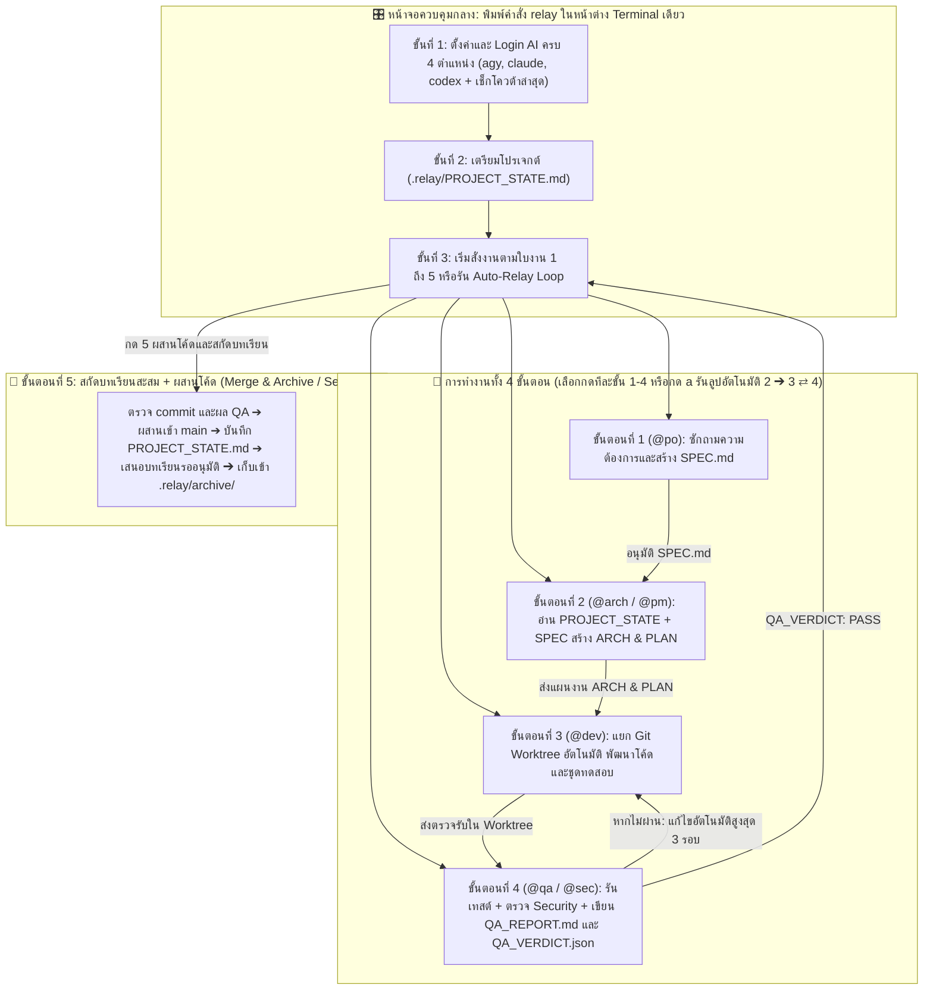

# RELAY (`.relay/`): มาตรฐานสถาปัตยกรรมการทำงานร่วมกับตัวแทน AI หลายค่ายผ่านหน้าจอควบคุมกลางและเอกสารกำหนดข้อตกลง (v1.0 Official Edition)

**ระบบจัดการกระบวนการพัฒนาซอฟต์แวร์ร่วมกับตัวแทน AI (`Google AI Ultra (agy)`, `Claude`, `Codex`) ผ่านหน้าจอควบคุม Terminal กลาง (`relay`) แบบนำทาง 3 ขั้นตอนอัตโนมัติ (Guided 3-Stage Progressive UX) และเอกสารส่งมอบงานในโฟลเดอร์ `.relay/`**  
*ใช้งานได้เต็มรูปแบบบน **macOS / Linux** (Windows รองรับบางส่วน) • ควบคุมทุกขั้นตอนในหน้าต่าง Terminal เดียว • รองรับโควต้า **Google AI Ultra (`agy`)** ทั้งโมเดล Gemini 4 Argon และ Claude 5.5 • ตรวจสอบการ Login และดึงรายชื่อโมเดลสดจาก CLI จริง • ส่งต่องานด้วยเอกสารสรุปสั้นแทนการสะสมบทสนทนายาว • เรียกใช้เฉพาะ CLI ทางการของแต่ละค่ายผ่านบัญชีของคุณเอง (ไม่ดึงหรือแชร์ token)*

---

## 1. ที่มาและหลักการทำงานของระบบ `RELAY`

ในการพัฒนาซอฟต์แวร์ด้วยตัวแทน AI (AI Coding Agents) การสั่งงานต่อเนื่องในหน้าต่างสนทนาเดียวเป็นเวลานาน หรือการต้องเปิดสลับหน้าต่างโปรแกรมหลายค่ายด้วยตนเอง มักก่อให้เกิดปัญหาสำคัญ 3 ประการ:
1. **ความคลาดเคลื่อนของผลลัพธ์เมื่อบริบทยาวเกินไป (Context Rot):** เมื่อประวัติการสนทนาสะสมมากขึ้น โมเดลภาษาจะเริ่มสับสนระหว่างข้อกำหนดเริ่มต้นกับการแก้ไขเฉพาะหน้า
2. **การสิ้นเปลืองโควตาการประมวลผล (Token Explosion):** ทุกข้อความใหม่ที่ส่งเข้าไปในหน้าต่างสนทนาเดิม ระบบจะต้องส่งประวัติการสนทนาทั้งหมดกลับไปประมวลผลซ้ำทุกครั้ง ทำให้โควตาของแพ็กเกจรายเดือนหมดลงอย่างรวดเร็ว
3. **ความยุ่งยากในการสลับเครื่องมือและความสับสนเมื่อเริ่มต้นใช้งาน:** การต้องคอยเปิด-ปิดและคัดลอกข้อความข้ามไปมาระหว่าง CLI หลายค่ายด้วยตนเองทำให้เสียเวลา และผู้ใช้ใหม่มักไม่ทราบว่าต้องเริ่มต้นตั้งค่าอะไรก่อน

### แนวทางแก้ไขของระบบ `RELAY`: หน้าจอควบคุมกลางแบบนำทาง 3 ขั้นตอน (`relay` Hub) + เอกสารส่งมอบงาน 4 ขั้นตอน (`.relay/`)
1. **ระบบนำทางทีละขั้นตอนอัตโนมัติ (`Guided 3-Stage Progressive UX`):** หน้าจอ `relay` ตรวจจับสถานะจริงของเครื่องและโฟลเดอร์ปัจจุบัน แล้วแสดงเฉพาะเมนูของขั้นตอนที่ต้องทำในขณะนั้น พร้อมตัวชี้ `❯` สีน้ำเงินครามตัวหนา (Minimalist High-Contrast Monochrome Blue) ที่ไม่ตัดสระภาษาไทย:
   - **ขั้นที่ 1 (`ตั้งค่า & Login AI ให้ครบ 4 ตำแหน่ง`):** ตรวจเช็ก 3 ชั้นจริง (ติดตั้ง CLI แล้ว + Login บัญชีแล้ว + เลือก Model แล้ว) หากยังไม่ครบจะแสดงเฉพาะเมนูตั้งค่าด่วนและเมนู Login
   - **ขั้นที่ 2 (`เลือกหรือเตรียมโฟลเดอร์โปรเจกต์`):** แจ้งเตือนทันทีหากเผลอรันในโฟลเดอร์ Home (`~`) พร้อมหน้าต่างเลือกโปรเจกต์ที่จำแนกสถานะชัดเจน โดยจัดเรียงโปรเจกต์ที่ติดตั้ง RELAY แล้ว (**`● [RELAY]`** สีเขียว พร้อมชื่อใบงานล่าสุด) ไว้ด้านบนสุด แยกจากโฟลเดอร์ทั่วไป (**`○ [ทั่วไป]`** สีเทา)
   - **ขั้นที่ 3 (`เริ่มสั่งงานตามใบงาน 1–5`):** เลื่อนตัวชี้ `❯` และป้าย `★ [ขั้นตอนถัดไป]` ไปยังขั้นตอนที่ต้องทำต่อให้อัตโนมัติตามไฟล์เอกสารที่มีในใบงาน
2. **เปิดใช้งานเฉพาะเมื่อต้องการ และแยกอิสระรายโปรเจกต์ (`On-Demand & Per-Project Isolation`):**
   - กระบวนการส่งมอบงาน 4 ขั้นตอน (`SPEC.md` + `Git Worktree`) จะทำงาน **เฉพาะในโปรเจกต์ที่มีโฟลเดอร์ `.relay/`** หรือเมื่อคุณสั่งรันผ่านคำสั่ง `relay` (`@po`, `@arch`, `@dev`, `@qa`) เท่านั้น ไม่ปะปนข้ามโปรเจกต์
   - เมื่อคุณเปิด `agy`, `claude`, หรือ `codex` ทำงานทั่วไปในโฟลเดอร์อื่นที่ไม่มี `.relay/` ตัวแทน AI จะทำงานตามคำสั่งปกติทันทีโดยไม่บังคับเขียน `SPEC.md` หรือสร้าง `Git Worktree` (คงไว้เฉพาะกฎพื้นฐานด้านความปลอดภัย เช่น ห้ามอ่าน/แก้ไข `.env*`, `*.key`)
3. **รองรับโควต้า Google AI Ultra (`agy`) เต็มรูปแบบควบคู่กับ `claude` และ `codex`:**
   - เชื่อมต่อกับ **Antigravity CLI (`~/.gemini/bin/agy`)** เพื่อใช้โควต้าแพ็กเกจ **Google AI Ultra** ได้โดยตรงทั้งก้อน **Gemini Models** (`gemini-4-argon-high`, `gemini-3.8-flash-high`) และก้อน **Claude & GPT Models** (`claude-opus-5-5-high`, `claude-sonnet-5-5-high`, `gpt-oss-120b-medium`)
   - ดึงรายชื่อโมเดลจาก CLI และแคชในเครื่อง (`agy models` เมื่อกดอัปเดต, `~/.codex/models_cache.json`, alias ของ `claude`) ถ้าดึงไม่ได้จะใช้รายการมาตรฐานที่ฝังไว้

---

## 2. องค์ประกอบหลักทั้ง 4 ส่วนของสถาปัตยกรรม `RELAY`

| องค์ประกอบหลัก | เครื่องมือมาตรฐานที่ใช้ | หน้าที่ความรับผิดชอบในระบบ |
| :--- | :--- | :--- |
| **1. หน้าจอควบคุมกลางแบบนำทาง 3 ขั้นตอน** | คำสั่ง **`relay`** (`relay.sh` / `relay.ps1`) + ไฟล์ **`relay-roles.conf`** | หน้าจอหลักสำหรับควบคุมการทำงานในหน้าต่าง Terminal เดียว ตรวจสอบสถานะการ Login จริง ดึงรายชื่อโมเดลสดจาก CLI และนำทางผู้ใช้ตั้งแต่ตั้งค่า AI ➔ เตรียมโปรเจกต์ ➔ สั่งงาน 4 ขั้นตอน |
| **2. ระบบจัดการเอกสารส่งมอบงานและสถานะโครงการ** | โฟลเดอร์ **`.relay/`** (ไฟล์ `.md` & `.json` มาตรฐาน)<br/>*(เปิดอ่านด้วย VS Code / Editor ใดก็ได้ หรือใช้ **Obsidian** เป็นตัวเลือกเสริม)* | จัดเก็บเอกสารสถานะโครงการ (`PROJECT_STATE.md`), เอกสารกำหนดความต้องการ (`SPEC.md`), แผนงาน (`ARCH.md`, `PLAN.md`), รายงานผล (`QA_REPORT.md`, `QA_VERDICT.json`) และบันทึกการทำงาน (`RUN_LOG.jsonl`) โดยไม่ต้องพึ่งพาโปรแกรมภายนอก |
| **3. บทบาทตัวแทน AI (สลับค่ายได้อิสระ) และสภาพแวดล้อมแยกอิสระ** | Official CLI (`agy`, `claude`, `codex`) + **`Git Worktree`** + ชุดทักษะ **`Skills`** | ผู้ใช้สามารถ **กด `[c]` เลือกสลับค่าย AI และโมเดลประจำตำแหน่ง (`@po`, `@arch`, `@dev`, `@qa`) ได้อิสระทุกบทบาท** ไม่ล็อกตายตัว พร้อมแยกกิ่งการพัฒนา (`.relay/worktrees/<task-id>`) ออกจากกิ่งหลัก (`main`) อัตโนมัติในขั้นตอนที่ 3 |
| **4. ระบบตรวจสอบความปลอดภัยและการทดสอบส่วนติดต่อผู้ใช้** | **`Global Git Hook`** + **[`microsoft/playwright-mcp`](https://github.com/microsoft/playwright-mcp)** + **[`trailofbits/skills`](https://github.com/trailofbits/skills)** & **[`semgrep/skills`](https://github.com/semgrep/skills)** | ป้องกันการบันทึกไฟล์ความลับ (`.env`) ด้วยสคริปต์ `pre-commit hook` ของระบบ (ไม่เรียก AI), สแกนช่องโหว่ความปลอดภัย และเมื่อมีการแก้ไข Web UI ให้ใช้ **Playwright MCP** ทดสอบบนเบราว์เซอร์จริงผ่านโควต้าแพ็กเกจรายเดือน |



---

## 3. การติดตั้งระบบตั้งแต่เริ่มต้น (รองรับทั้ง Windows และ macOS)

> 📖 **สำหรับผู้เริ่มต้นที่ยังไม่มีเครื่องมือพื้นฐานในเครื่อง:** สามารถศึกษาขั้นตอนการติดตั้งแบบละเอียดทีละขั้นตอนได้ที่เอกสาร **[`docs/INSTALL_ZERO_TO_HERO.md`](./docs/INSTALL_ZERO_TO_HERO.md)**

### ขั้นตอนที่ 3.1: ติดตั้งโปรแกรมพื้นฐาน (Git, Node.js) และ Official CLI

#### 🍎 สำหรับระบบปฏิบัติการ macOS (รันใน `Terminal`)
```bash
# 1. ติดตั้ง Git, Node.js และ pnpm ผ่าน Homebrew
brew install git node pnpm

# 2. ติดตั้ง Official CLI ของผู้ให้บริการที่คุณใช้งาน
#    (หากมี Google AI Ultra / Antigravity จะมี ~/.gemini/bin/agy พร้อมใช้งานอยู่แล้ว)
npm install -g @anthropic-ai/claude-code @openai/codex

# (ทางเลือกเสริม — ไม่บังคับ) ติดตั้ง Obsidian สำหรับเปิดดูเอกสาร .md แบบกราฟิก
# brew install --cask obsidian
```

#### 🪟 สำหรับระบบปฏิบัติการ Windows (คลิกขวาเปิด `PowerShell` แบบ Run as Administrator)
```powershell
# 1. ติดตั้ง Git และ Node.js (LTS) ผ่าน winget
winget install --id Git.Git -e --source winget
winget install --id OpenJS.NodeJS.LTS -e --source winget
Set-ExecutionPolicy -ExecutionPolicy RemoteSigned -Scope CurrentUser -Force

# 2. ปิดหน้าต่าง PowerShell แล้วเปิดใหม่ 1 ครั้ง จากนั้นติดตั้ง Official CLI
npm install -g @anthropic-ai/claude-code @openai/codex

# (ทางเลือกเสริม — ไม่บังคับ) ติดตั้ง Obsidian สำหรับเปิดดูเอกสาร .md แบบกราฟิก
# winget install --id Obsidian.Obsidian -e --source winget
```

---

### ขั้นตอนที่ 3.2: ติดตั้งระบบ `RELAY` และคำสั่งหน้าจอควบคุมกลาง (`relay`)

สคริปต์ติดตั้งจะทำการสร้างโฟลเดอร์ส่วนกลาง (`~/.agents/` บน macOS หรือ `%USERPROFILE%\.agents\` บน Windows) เชื่อม Symlink คำสั่ง `agy` (หากมีใน `~/.gemini/bin/agy`) และติดตั้งคำสั่ง **`relay`** เข้าสู่ `PATH` ของระบบ ทำให้คุณสามารถพิมพ์คำว่า **`relay`** ได้จากทุกโฟลเดอร์โครงการในเครื่องทันที

> **หมายเหตุ (macOS / Linux):** ถ้าเครื่องมี `~/.claude/CLAUDE.md`, `~/.codex/AGENTS.md`, `~/.gemini/GEMINI.md` หรือ `~/.agents/GLOBAL_AGENTS.md` ที่แก้ไว้เองอยู่แล้ว สคริปต์จะสำรองเป็น `*.bak.<วันเวลา>` ก่อนแทนที่ • สคริปต์ตั้ง `git config --global core.hooksPath ~/.agents/hooks` เฉพาะเมื่อยังไม่มีค่านี้ และ hook เดิมใน `.git/hooks/` ของแต่ละ repo ยังทำงานต่อผ่านตัวส่งต่อของ RELAY

#### 🍎 คำสั่งติดตั้งบน macOS / Linux:
```bash
git clone https://github.com/bosocmputer/RELAY.git
cd RELAY
chmod +x setup-mac.sh relay.sh relay-init.sh relay-skills.sh
./setup-mac.sh
source ~/.zshrc
./relay-skills.sh install
```

#### 🪟 คำสั่งติดตั้งบน Windows (PowerShell):
```powershell
git clone https://github.com/bosocmputer/RELAY.git
cd RELAY
.\setup-win.ps1
.\relay-skills.ps1 install
```

> [!WARNING]
> บน Windows (`relay.ps1`) แดชบอร์ด การตั้งค่าค่าย AI และโควต้าใช้งานได้ แต่ **`[a]` Auto-Relay Loop และ `[l]` Self-Learning ยังไม่รองรับเต็มรูปแบบ** (อยู่ระหว่างพัฒนา) — แนะนำให้ใช้ผ่าน macOS / Linux หรือ WSL ไปก่อน

---

## 4. การตั้งค่าจับคู่ตำแหน่งกับค่าย AI (สลับค่ายได้อิสระทุกบทบาท) และการใช้งานหน้าจอ Terminal กลาง (`relay`)

### 4.1 ค่ายผู้ให้บริการและโมเดลที่รองรับ (`relay config` หรือกด `c`)
> 💡 **ไม่ได้ล็อกตายตัวตามบทบาท:** ทั้ง 4 ตำแหน่ง (`1. @po`, `2. @arch/@pm`, `3. @dev`, `4. @qa/@sec`) สามารถ **สลับค่าย AI และเปลี่ยนโมเดลได้อย่างอิสระตลอดเวลา** ผ่านปุ่ม **`c`** (`relay config`) เช่น หากโควต้าของค่ายใดใกล้หมด หรือคุณมีเฉพาะแพ็กเกจของค่ายเดียว ก็สามารถตั้งให้ทุกบทบาทใช้ค่ายเดียวกันหรือผสมค่ายตามต้องการได้ทันที

รันคำสั่ง `relay config` (หรือกดปุ่ม `c` ในหน้าจอหลักของ `relay`) เพื่อกำหนดค่าย AI และโมเดลประจำตำแหน่ง หรือเลือก **Quick Setup** ในคลิกเดียว:
- **`agy` (Google AI Ultra / Antigravity CLI):** ดึงรายชื่อโมเดลสดจาก `agy models` ใช้โควต้า Google AI Ultra ได้ทั้งก้อน Gemini และก้อน Claude/GPT:
  - โควต้า Gemini: `gemini-4-argon-high`, `gemini-4-argon-medium`, `gemini-4-argon-low`, `gemini-3.8-flash-high`, `gemini-3.8-flash-medium`, `gemini-3.8-flash-low`
  - โควต้า Claude & GPT: `claude-opus-5-5-high`, `claude-opus-5-5-medium`, `claude-opus-5-5-low`, `claude-sonnet-5-5-high`, `claude-sonnet-5-5-medium`, `claude-sonnet-5-5-low`, `gpt-oss-120b-medium`
- **`codex` (OpenAI Codex CLI):** ดึงรายชื่อโมเดลสดจาก `~/.codex/models_cache.json` เช่น `gpt-6.1-terra`, `gpt-6.1-terra-mini`
- **`claude` (Anthropic Claude Code CLI):** รองรับ `opus`, `sonnet`, `haiku`

### 4.1.1 การจัดการบทบาท Agent, คำสั่ง Prompt, ทักษะ และการเพิ่มตำแหน่งใหม่ (`[g]` / `/agents` หรือ `relay agents`)
นอกจากการสลับค่ายและโมเดลผ่านปุ่ม `[c]` แล้ว คุณสามารถกดปุ่ม **`g`** (หรือพิมพ์ `/agents` หรือรัน `relay agents`) เพื่อจัดการบทบาทและคำสั่งได้ทั้งระดับ **ใช้ร่วมกันทุกโปรเจกต์ (`~/.agents/custom-agents.json`)** และ **เฉพาะโปรเจกต์นี้ (`.relay/custom-agents.json`)**:
- **ปรับแต่ง 4 ตำแหน่งหลัก (`@po`, `@arch`, `@dev`, `@qa`):** แก้ไขชื่อบทบาท กำหนดคำสั่ง Prompt เพิ่มเติม เลือกชุดทักษะ (`Skills`) ประจำตำแหน่ง เปลี่ยนค่าย/โมเดล หรือรีเซ็ตกลับเป็นค่าเริ่มต้นได้ตลอดเวลา
- **เพิ่มและสั่งงาน Agent ตำแหน่งใหม่ (`@ux`, `@devops`, `@data` ฯลฯ):** สร้างตำแหน่งใหม่พร้อมตั้งชื่อ คำสั่ง Prompt ประจำตำแหน่ง เลือกทักษะ (`Skills`) และกำหนดค่าย AI + โมเดล โดยสามารถสั่งรันงานได้ทันทีจากหน้าจอหลัก (เลือกทำงานใน `Project Root` หรือแยก `Git Worktree`), ทดสอบความพร้อมใน `[t]`, และบันทึกสถิติเวลา + Token จาก session log ใน `[v]` (`relay stats`)
- **รองรับการย้อนกลับทุกเมนู (`[b] ย้อนกลับ` และปุ่ม `ESC`):** ทุกเมนูย่อย หน้าเลือกค่าย AI หน้าเลือกโมเดล และทุกช่องรับข้อความรองรับการกด `b` หรือ `ESC` เพื่อย้อนกลับไปยังหน้าก่อนหน้าโดยไม่เสียค่าที่ตั้งไว้เดิม

### 4.2 การเปิดหน้าจอควบคุมกลาง (`relay`)
เมื่อพิมพ์คำสั่ง `relay` ใน Terminal หน้าจอควบคุมกลางจะแสดงเป็นภาษาไทยเป็นหลัก (ชื่อไฟล์ ชื่อบทบาท ปุ่มลัด และชื่อค่าย/โมเดลคงเป็นภาษาอังกฤษ) แบ่งกรอบซ้าย-ขวา: ซ้ายเป็นโลโก้ RELAY + โปรเจกต์และงานปัจจุบัน ขวาเป็นตำแหน่ง AI, ตารางโควต้า และความคืบหน้า พร้อมระบบนำทาง **Guided 3-Stage Progressive UX** (ตัวอย่างด้านล่างเป็นผลจริงจากเครื่องทดสอบ):

```text
╭──────────────────────────────── RELAY v1.0.0 ─────────────────────────────────────────────────────────────────────╮
│                                 ตำแหน่ง AI                                                                         │
│     ▐█████▄                     @po:       agy (gemini-4-argon-high)  ● พร้อมใช้                                    │
│     ▐█    ▐█   ━━━▶             @arch/pm:  agy (claude-opus-5-5-high)  ● พร้อมใช้                                   │
│     ▐█████▀     ━━▶             @dev:      agy (claude-sonnet-5-5-high)  ● พร้อมใช้                                 │
│     ▐█   ▀█▄     ━▶             @qa/sec:   codex (gpt-6.1-terra)  ● พร้อมใช้                                        │
│     ▐█     ▀█▄                                                                                                    │
│                                 โควต้า (5 ชม. / 7 วัน)  อัปเดต 10:15:02 (เมื่อสักครู่) • กด [u] ดึงข้อมูลสด                  │
│      R E L A Y                  ค่าย / กระเป๋า      รอบ 5 ชม.                   รอบ 7 วัน                            │
│    ทีม AI ส่งไม้ต่อกัน               agy (Gemini)      ● 81%  อีก 1ชม.26น. (11:42)  ▲ 49%  อีก 1วัน 12ชม. (02 พ.ย. 00:10) │
│                                 agy (Claude/GPT)  ● 100%                      ● 99%                               │
│    Google AI Ultra · Codex      codex (Plus)      ● 70%  อีก 1ชม.17น. (11:33)  ● 61%                               │
│      …/my-project (main)        claude (Pro)      ▲ 35%                       ▲ 13%                               │
│    งาน: 20261031-user-auth                                                                                        │
│                                 ความคืบหน้าและสถิติ                                                                   │
│                                 เอกสาร:    ● SPEC  ● ARCH  ● PLAN  ○ QA  ·  ● PROJECT_STATE.md  ·  ○ กฎ 0 ข้อ      │
│                                 สถิติ:     ยังไม่มีการรัน AI ในงานนี้ · กด [v] ดูสถิติ                                       │
│                                 ถัดไป:     [3] @dev เขียนโค้ดใน Git Worktree หรือ [a] ลูปอัตโนมัติ (3⇄4)                  │
╰───────────────────────────────────────────────────────────────────────────────────────────────────────────────────╯

  ขั้นตอนการทำงาน (↑/↓ เลือก • Enter รัน • หรือกดปุ่ม)
    [1] @po            เขียนความต้องการ (SPEC.md) · agy/gemini-4-argon-high
    [2] @arch & @pm    ออกแบบและวางแผน (ARCH.md, PLAN.md) · agy/claude-opus-5-5-high
  ❯ [3] @dev           เขียนโค้ด + เทสต์ใน Git Worktree · agy/claude-sonnet-5-5-high
    [4] @qa & @sec     ตรวจเทสต์ ความปลอดภัย (QA_REPORT.md) · codex/gpt-6.1-terra
    [5] ผสานโค้ด        ผสานกิ่งเข้า main และปิดงาน
    [a] ลูปอัตโนมัติ      รันขั้น 2 → 3 ⇄ 4 ให้อัตโนมัติ (/loop)
    [x] งานด่วน         ข้าม @po / @arch ให้ @dev แก้ใน Worktree (/fast)

  ปุ่มลัด
  [c] โมเดล    [g] ตำแหน่ง   [u] โควต้า   [v] สถิติ    [l] กฎ
  [n] งานใหม่   [f] โปรเจกต์  [t] ทดสอบ   [d] Login    [s] Skills  [q] ออก
```

> **โฟลเดอร์โปรเจกต์:** หน้าเลือกโปรเจกต์ (`[f]`) สแกน `RELAY_WORKSPACE` (ถ้ากำหนด) และ `~/Projects`, `~/dev`, `~/code`, `~/workspace`, `~/Developer` ที่มีอยู่จริง ถ้าเก็บโปรเจกต์ไว้ที่อื่นให้เพิ่ม `export RELAY_WORKSPACE="$HOME/โฟลเดอร์ของคุณ"` ใน `~/.zshrc` • เปลี่ยนรูปโลโก้ได้ด้วย `RELAY_LOGO_STYLE=minimal`

### 4.3 การตรวจสอบโควต้าคงเหลือของทุกค่าย (`[u]` / `/quota` หรือ `relay quota`)
หน้าจอหลักแสดง **ตารางโควต้า 3 คอลัมน์ (ค่าย / 5 ชั่วโมง / รายสัปดาห์)** พร้อม **นับถอยหลังเวลารีเซ็ต** เช่น `อีก 1ชม.27น. (20:27)` หรือ `อีก 1วัน 13ชม. (31 ต.ค. 08:10)` โดยคำนวณจากเวลารีเซ็ตที่แคชไว้ทุกครั้งที่วาดหน้าจอ จึงนับต่อได้แม้ข้อมูลจะดึงมาสักพักแล้ว (แคชถูก refresh เบื้องหลังเมื่อเก่ากว่า 3 นาที)
- **เลยเวลารีเซ็ตแล้ว:** แสดง `↻ รีเซ็ตแล้ว` และถือว่าโควต้ารอบนั้นเป็น 100% จนกว่าจะดึงค่าใหม่ (ทั้งบนหน้าจอและใน Quota Circuit Breaker ของ Auto-Loop)
- **อายุข้อมูล:** หัวตารางบอกว่าดึงข้อมูลมาเมื่อไร (`6 นาทีที่แล้ว`) และขึ้นสีเตือนเมื่อเก่ากว่า 15 นาที
- กดปุ่ม **`u`** (หรือพิมพ์ `/quota`, `/usage`, หรือรัน `relay quota`) เพื่อดึงค่าสดพร้อมหลอดโควต้าละเอียดจากทั้ง 3 ค่าย:
  - **`agy` (Google AI Ultra):** แยกกระเป๋า **Gemini Models** และ **Claude & GPT Models** จาก `agy -p "/usage"`
  - **`codex` (OpenAI Codex CLI):** จากเซสชันล่าสุดใน `~/.codex/sessions`
  - **`claude` (Anthropic Claude Code CLI):** จาก Control Protocol `get_usage` ของ `claude`

### 4.4 การรันลูปอัตโนมัติแบบมีเบรกนิรภัยและการสลับโควต้าอัจฉริยะ (`Bounded Auto-Relay Loop & Smart Quota Failover` — `[a]` / `/loop` หรือ `relay loop`)
เมื่อคุณร่วมกับ `@po` สรุปขอบเขตงานลงใน `SPEC.md` (ขั้นตอนที่ 1) เสร็จแล้ว คุณสามารถเลือกทำงานต่อได้ทั้งแบบทีละก้าว (`[2] ➔ [3] ➔ [4]`) หรือกด **`a`** (`/loop` หรือ `relay loop`) เพื่อให้ `RELAY` รันวงรอบอัตโนมัติ **`2 (@arch) ➔ 3 (@dev ใน Worktree) ⇄ 4 (@qa ผู้ตรวจรับต่างค่าย)`** พร้อม **ระบบเบรกนิรภัยและการสลับกระเป๋าโควต้าอัตโนมัติ**:
1. **Quota Guard & Smart Failover (`< 20%`):** ก่อนเริ่มทุกขั้นตอน ระบบตรวจโควต้าคงเหลือจริง (`5h` และ `7d`) ของตำแหน่งถัดไป หากต่ำกว่า **`20%`**:
   - **โหมด `Smart Auto-Failover` (ค่าเริ่มต้นเมื่อเลือกข้อ `[y]` ในเมนูเริ่มลูป หรือสั่ง `relay loop --auto-failover`):** ระบบจัดอันดับกระเป๋าโควต้าที่พร้อมใช้งานในเครื่อง (`agy Gemini`, `agy Claude/GPT`, `codex`, `claude`) แล้วสลับไปยังกระเป๋าที่มีโควต้าสูงสุด (`>= 50%`) ให้อัตโนมัติและทำงานต่อทันที • ค่ายใหม่ถูกบันทึกเฉพาะ `.relay/roles.conf` ของโปรเจกต์นั้น (ไม่แก้ค่า Global ของโปรเจกต์อื่น)
   - **โหมดถามยืนยันหน้าจอ (`1-Click In-Place Quota Switcher`):** แสดงเมนูทางลัดให้กดปุ่มเดียว (`[1]`, `[2]`) เพื่อสลับไปใช้กระเป๋าที่โควต้าเหลือเยอะแล้วทำต่อทันที หรือกด **`[f]`** เพื่อฝืนรันต่อด้วยโมเดลเดิมในรอบนี้โดยไม่ต้องออกจากลูปไปหน้าตั้งค่า
   - **กู้คืนงานเมื่อโควต้าหมดกลางคัน (`Mid-Step Failover Guard`):** หาก CLI จบด้วยข้อผิดพลาดกลางคันระหว่างกำลังเขียนโค้ด ระบบรองรับการสลับค่ายเพื่อรับไม้ต่อใน `Git Worktree` เดิมทันที
2. **Worktree Handoff Context:** เมื่อมีการสลับค่ายหรือรันซ้ำใน `Git Worktree` เดิมที่มีงานทำค้างอยู่ สคริปต์ระบบจะรัน `git status --short`, `git diff --shortstat`, และ `git log main..HEAD` (ไม่เรียก AI แต่ข้อความสรุปที่แนบเข้า Prompt นับเป็น Token ของ Prompt) เพื่อแนบสรุปรายชื่อไฟล์ที่แก้ไขค้างไว้เข้าสู่ Prompt ของ AI ตัวใหม่โดยอัตโนมัติ ทำให้รับไม้ต่อจากจุดเดิมได้ทันทีโดยไม่ต้องเริ่มเขียนใหม่
3. **Max Remediation Cap = 3 รอบ:** หาก `@qa` ระบุ `VERDICT: FAIL` ระบบส่งกลับให้ `@dev` แก้ไขอัตโนมัติสูงสุด **3 รอบ** (บันทึกทุกรอบใน `.relay/tasks/<task-id>/LOOP_LOG.md` และเก็บรายงานรอบก่อนเป็น `QA_REPORT.before-round-N.md`)
4. **Cross-Provider Verification:** `@qa` ต้องเขียน **`QA_VERDICT.json`** (`verdict`, `failed_criteria`, `tests_run`, `summary`) — ผ่านเฉพาะเมื่อ `verdict` เป็น `PASS` และไม่มี `failed_criteria`; JSON เสียรูปแบบหรือไม่มี VERDICT จะ**ไม่**นับว่าผ่าน (ถ้าไม่มี JSON จะใช้ `VERDICT:` ใน `QA_REPORT.md` เป็นทางสำรองและบันทึกไว้ใน `LOOP_LOG.md`)
5. **Step Guard:** หยุดลูปทันทีเมื่อไม่สร้างไฟล์ที่ต้องได้ (`PLAN.md` / `QA_REPORT.md` หรือ `QA_VERDICT.json`), หรือทำงานเกิน **30 นาทีต่อขั้น** (ปรับได้ด้วย `RELAY_STEP_TIMEOUT=<วินาที> relay loop`)

จบลูปแล้วระบบแสดงสรุปเวลา จำนวน Token จาก session log และโควต้าที่ใช้ต่อขั้น และทุกการเรียก agent (ทั้งแบบกดทีละขั้น โหมดด่วน Fast Track และอัตโนมัติ) ถูกบันทึกลง `.relay/tasks/<task-id>/RUN_LOG.jsonl` เพื่อดูต้นทุนย้อนหลังได้

### 4.4.1 ตัวชี้วัดความเร็ว + Token รายขั้นตอน/รายโมเดล (`[v]` / `/stats` หรือ `relay stats`) และโหมดด่วน `Fast Track` (`[x]` / `/fast` หรือ `relay fast`)
เพื่อให้คุณประเมินความคุ้มค่าของ **"ความเร็ว + Token"** ได้ด้วยตัวเองจากตัวเลขจริง ไม่ต้องพึ่งการคาดเดา:
- **กล่องสรุปหลังจบทุกขั้นตอน (`Step Telemetry Box`):** ทันทีที่จบการรันแต่ละขั้น ระบบดึงตัวเลข Token (`Input`, `Cached`, `Output`, `Total Tokens`) จากไฟล์ Session Log ของ `agy`, `codex`, และ `claude` ในเครื่อง มาแสดงคู่กับเวลาที่ใช้จริง (`⏱`) และโควต้าก่อน➔หลัง (`📉`) • `claude` / `codex` นับเฉพาะ session ในโฟลเดอร์ที่รันขั้นตอนนั้น ส่วน `agy` ไม่บันทึกโฟลเดอร์ จึงเป็นค่าประมาณที่รวม session agy อื่นที่รันช่วงเดียวกัน • ถ้าไม่พบข้อมูลจะแสดง `ไม่พบข้อมูล Token` (ไม่นับเป็น 0)
- **รายงานเปรียบเทียบรายขั้นตอนและรายโมเดล (`[v]` หรือ `relay stats`):** แสดงตารางแยกตามขั้นตอนของใบงานปัจจุบัน และตารางเปรียบเทียบยอดสะสมแยกตามค่าย/โมเดล (`agy/gemini-4-argon-high`, `agy/claude-opus-5-5-high`, `codex/gpt-6.1-terra`, `claude/sonnet` ฯลฯ)
- **โหมดด่วน `Fast Track` (`[x]` หรือ `relay fast`):** สำหรับงานเล็กหรือการแก้บั๊กที่ไม่คุ้มจะเปิดครบ 4 บทบาท กด **`x`** เพื่อข้ามพิธีกรรม `@po` และ `@arch` ระบบจะสร้าง Worktree แยกและส่ง `@dev` ลงมือแก้โค้ดพร้อมรันเทสต์ทันที ช่วยประหยัดเวลาเปิด-ปิด CLI และประหยัด Token จากการเขียนเอกสาร `ARCH.md` / `PLAN.md` • ผลตรวจที่ `@dev` เขียนเองแสดงเป็น `▲ QA PASS (self)` และขั้นตอนที่ 5 ยังถามยืนยันก่อนผสาน (แนะนำให้กด `[4]` ให้ `@qa` ตรวจก่อน)

> [!NOTE]
> ในโหมดอัตโนมัติ RELAY เรียกแต่ละค่ายด้วยโหมดสิทธิ์ที่ไม่ต้องถามโต้ตอบแต่ไม่ข้ามระบบสิทธิ์ทั้งหมด: `agy --mode auto`, `claude --permission-mode acceptEdits` และ `codex exec --full-auto` — หากใช้ `claude` เป็น `@dev` และต้องการให้รันคำสั่งทดสอบได้เอง ให้เพิ่ม allow rule ของคำสั่งนั้นใน `.claude/settings.json`

### 4.5 ขั้นตอนที่ 5: ผสานโค้ดอย่างปลอดภัยพร้อมด่านตรวจไฟล์ความลับ (`[5]` / `relay 5`)
ก่อนผสาน ระบบจะแสดงจำนวน commit ใหม่, ไฟล์ที่ยังไม่ commit ใน Worktree, การตรวจหาไฟล์ความลับต้องห้าม และผลตรวจรับล่าสุด แล้วทำงานตามลำดับนี้ **โดยไม่ลบอะไรจนกว่าจะผสานสำเร็จ**:
- **ด่านตรวจไฟล์ความลับและฐานข้อมูลต้องห้าม (`worktree_forbidden_files`):** หากพบไฟล์ `.env`, `.env.*` (ยกเว้นไฟล์ตัวอย่าง `.env.example`/`.env.sample`/`.env.template`), `*.key`, `*.pem`, `*.sqlite*`, หรือ `*.db` ทั้งในไฟล์ค้างหรือใน commit ของกิ่งงาน ระบบจะ **บล็อกการ commit และผสานทันที** จนกว่าจะลบหรือเพิ่มเข้า `.gitignore`
- ผลตรวจรับยังไม่เป็น `PASS` ➔ ขอยืนยันเพิ่มอีกชั้น (ค่าเริ่มต้นคือยกเลิก)
- กิ่งหลักมีไฟล์ที่ track แล้วแก้ค้างไว้ (นอก `.relay/` และ `.gitignore`) ➔ หยุดก่อนผสาน ให้ commit หรือ stash ก่อน
- มีไฟล์ค้างใน Worktree ➔ เสนอ commit อัตโนมัติ (ไม่รวมโฟลเดอร์ `.relay/` และไม่รวมไฟล์ความลับต้องห้าม) ก่อนผสาน
- กิ่งไม่มีโค้ดใหม่ ➔ ไม่ลบ Worktree หรือกิ่ง
- ผสานด้วย `git merge --no-ff`; ถ้าเกิด conflict ➔ ยกเลิกการผสาน (`git merge --abort`) และเก็บ Worktree กับใบงานไว้ครบ
- ผสานสำเร็จ ➔ บันทึกใบงานลงหัวข้อ "ประวัติใบงานที่ผสานแล้ว" ใน `PROJECT_STATE.md` ➔ เสนอบทเรียนเข้าคิวรออนุมัติ ➔ ลบ Worktree และกิ่ง ➔ ย้ายใบงานเข้า `.relay/archive/`
- `PROJECT_STATE.md` ของกิ่งหลักถูกแก้เฉพาะขั้นตอนนี้เท่านั้น (`@qa` และ agent ใน Worktree อ่านได้แต่ห้ามแก้)

### 4.6 ระบบทักษะแบบเปิดเผยข้อมูลเป็นขั้นบันได (`Progressive Disclosure Skill Index`), `Scripts as Tools` และการสกัดบทเรียนจากหลักฐานจริง (`[l]` / `/learn` หรือ `relay learn`)
ผสานแนวคิด **Anthropic Agent Skills (`Progressive Disclosure` + `Scripts as Tools`)** เข้ากับ **Hermes (`Evidence-Based Skill Distillation`)** และ `tigerless-labs/autoharness`:
- **Progressive Disclosure Skill Index:** แทนที่จะโหลดเนื้อหา `SKILL.md` ทั้งหมดเข้า Context Window ล่วงหน้า ระบบจะสแกนเฉพาะหัว YAML Frontmatter (`name`, `description` ย่อ ≤80 ตัวอักษร), พาธจริงของ `SKILL.md` และรายชื่อสคริปต์ในโฟลเดอร์ `scripts/` ทั้งจาก `.relay/skills/` และ `~/.agents/skills/` เพื่อแนบเป็นสารบัญสั้นๆ ให้ Agent ทุกค่าย (`agy`, `claude`, `codex`) เห็นตรงกันและเปิดอ่าน `SKILL.md` เฉพาะใบที่ตรงกับงานจริง
- **Scripts as Tools (`relay-verify-task` & `scripts/`):** สนับสนุนการบรรจุสคริปต์ตรวจสอบซ้ำไว้ในโฟลเดอร์ `scripts/` ของแต่ละ Skill พร้อมติดตั้งสคริปต์มาตรฐาน **`relay-verify-task`** (`templates/scripts/verify-relay-task.sh`) ให้ `@dev` และ `@qa` สั่งตรวจเพดานบรรทัดเอกสาร (`SPEC.md` ≤40, `ARCH.md`+`PLAN.md` ≤60, `QA_REPORT.md` ≤30), ตรวจไฟล์ความลับต้องห้าม และตรวจโครงสร้าง `QA_VERDICT.json` ได้ด้วยคำสั่งเดียว (สคริปต์ ไม่เรียก AI)
- **Evidence-Based Skill Distillation (`[l]` / `/learn`):** เมื่อคุณกด **`[5] Merge & Archive`** (หรือกด **`l`** ➔ ข้อ 2) ระบบจะสกัดทั้งกฎสถาปัตยกรรมและ **บทเรียนจากหลักฐานการแก้บั๊กข้ามรอบ** (`QA_VERDICT.before-round-*.json` ที่รอบแรกได้ `FAIL` แล้วแก้จน `PASS` ในรอบถัดไป) เข้าคิว **`.relay/skills/project-learned/PENDING.md`**
- **กฎในคิวยังไม่ถูกส่งให้ AI** จนกว่าคุณจะกด **`l`** ➔ ข้อ 1 แล้วเลือกอนุมัติรายข้อ (`1,3`), ทั้งหมด (`a`) หรือปฏิเสธทั้งหมด (`x`) — ป้องกันกฎผิดที่ AI เขียนเองถูกส่งต่อไปทุกใบงาน (แดชบอร์ดจะขึ้น `▲ N pending [l]` เมื่อมีกฎในคิว)
- กฎที่อนุมัติแล้วย้ายเข้า **`.relay/skills/project-learned/SKILL.md`** (ไม่ซ้ำ, ไม่เกิน **25 ข้อ**) และทุกการเสนอ/อนุมัติ/ปฏิเสธถูกบันทึกแบบ Append-Only ใน **`.relay/skills/project-learned/LEDGER.md`** — แก้หรือลบกฎใน `SKILL.md` ด้วยมือได้ตลอด
- **ขอบเขตความปลอดภัย (Self-Authored Only Guardrail):** เขียนเฉพาะภายใน `.relay/skills/project-learned/` ของโปรเจกต์นั้นๆ เท่านั้น ไม่แตะต้องไฟล์กฎส่วนกลาง `~/.agents/GLOBAL_AGENTS.md` และแนบเข้าสู่ Prompt ของ `@arch`, `@dev`, และ `@qa` ในใบงานถัดไปอัตโนมัติครบทุกค่าย (`agy`, `codex`, `claude`)

### 4.7 การทดสอบความพร้อมของตัวแทน AI แต่ละตำแหน่ง (`[t]` หรือ `relay test`)
คุณสามารถกดปุ่ม **`t`** ในหน้าจอหลัก (หรือพิมพ์คำสั่ง `relay test`) เพื่อตรวจสอบความพร้อมทั้ง 2 ระดับ:
1. **ตรวจสอบทักษะ การ Login และกฎส่วนกลางในเครื่อง (Static Readiness Check):** แสดงรายการทักษะ (`Skills`) ประจำตำแหน่งของ `@po`, `@arch/@pm`, `@dev`, และ `@qa/@sec` พร้อมสถานะการเชื่อมต่อไฟล์กฎส่วนกลาง (`GLOBAL_AGENTS.md`)
2. **ยิงคำสั่งทดสอบให้ AI แต่ละตำแหน่งรายงานตัวจริง (Live Agent Handshake):** ส่งคำสั่งทดสอบไปยัง CLI และ Model ที่ตั้งไว้ของแต่ละตำแหน่ง (`agy --model <m> -p`, `codex exec`, `claude -p`) เพื่อยืนยันว่า CLI และโมเดลนั้นรับคำสั่งและตอบกลับได้จริง

---

## 5. การเปิดดูเอกสารใน `.relay/` ด้วยโปรแกรม Obsidian (ทางเลือกเสริม — ไม่บังคับติดตั้ง)

### 5.1 Obsidian คืออะไรในระบบ `RELAY`? (ใช้หรือไม่ใช้ก็ได้)
ระบบ `RELAY` จัดเก็บเอกสารส่งมอบงานทั้งหมดเป็นไฟล์ Markdown (`.md`) และ JSON มาตรฐานในโฟลเดอร์ `.relay/` โดยตรง **ตัวสคริปต์ไม่ได้ผูกติดหรือบังคับต้องมีโปรแกรม Obsidian** คุณสามารถเปิดอ่านและแก้ไขไฟล์ใน `.relay/` ด้วย VS Code, Cursor หรือโปรแกรมแก้ไขข้อความใดก็ได้

อย่างไรก็ตาม หากคุณต้องการแยก **"หน้าจอดูเอกสารและแผนผังของทีม AI"** ออกจากหน้าจอเขียนโค้ด การเปิดโฟลเดอร์ `.relay/` ในโปรแกรม **Obsidian (ทางเลือกเสริม ใช้งานฟรีสำหรับบุคคลทั่วไป)** ไว้ด้านข้าง Terminal จะช่วยให้เห็นเอกสาร `PROJECT_STATE.md`, `SPEC.md`, `ARCH.md`, `PLAN.md`, แผนภาพ Mermaid และรูปแคปหน้าจอใน `QA_REPORT.md` ที่ Obsidian โหลดใหม่ให้เองเมื่อไฟล์เปลี่ยน
- **ลิงก์ดาวน์โหลด (ทางเลือกเสริม):** [https://obsidian.md](https://obsidian.md)

### 5.2 วิธีเปิดโฟลเดอร์ `.relay/` ในโปรแกรม Obsidian (กรณีต้องการใช้)
1. เปิดโปรแกรม **Obsidian** ➔ คลิกปุ่ม **"Open folder as vault"** (เปิดโฟลเดอร์เป็นคลังข้อมูล)
2. เลือกเข้าไปที่โฟลเดอร์ **`.relay`** ภายในโครงการของคุณ (เช่น `my-project/.relay`) แล้วกด **Open**
   *(สำหรับผู้ใช้ macOS: หากไม่เห็นโฟลเดอร์ `.relay` ในหน้าต่างเลือกไฟล์ ให้กดปุ่มลัด `Command (⌘) + Shift + .` เพื่อแสดงโฟลเดอร์ที่ขึ้นต้นด้วยจุด)*

---

## 6. วิธีการนำระบบ `RELAY` ไปใช้งานจริง (2 กรณีศึกษาหลัก)

> 📖 ศึกษารายละเอียดเชิงลึกเพิ่มเติมได้ที่ **[`docs/USE_CASES_NEW_AND_EXISTING.md`](./docs/USE_CASES_NEW_AND_EXISTING.md)**

### กรณีศึกษาที่ 1: การเริ่มต้นโครงการใหม่ตั้งแต่ศูนย์ (Greenfield Project)
1. พิมพ์คำสั่ง **`relay`** ใน Terminal (หากคุณเผลอพิมพ์ในโฟลเดอร์ `~` ระบบจะขึ้น **ขั้นที่ 2/3** ให้คุณกด Enter ที่ข้อ `[1]` เพื่อสร้างและย้ายเข้าโฟลเดอร์โปรเจกต์ใหม่ให้อัตโนมัติ)
2. ในหน้าจอ **ขั้นที่ 2/3 (`เตรียมโครงสร้าง .relay/`)** กด Enter ที่ข้อ **`[1] ★ เริ่มโปรเจกต์ใหม่ตั้งแต่ศูนย์ในโฟลเดอร์นี้ (Greenfield)`**
3. ระบบจะเข้าสู่ **ขั้นที่ 3/3 (`เริ่มสั่งงาน`)** พร้อมเลื่อนตัวชี้ `❯` ไปยังขั้นตอนถัดไปให้อัตโนมัติ:
   - กด **`1`** (`@po`) ➔ ซักถามความต้องการและสร้าง `SPEC.md`
   - **ทางเลือกที่ A (สั่งรันลูปอัตโนมัติ):** กด **`a`** (`Auto-Relay Loop`) ➔ ระบบรันขั้นตอนที่ `2 (@arch) ➔ 3 (@dev ใน Worktree) ⇄ 4 (@qa ต่างค่าย)` ให้อัตโนมัติจนผ่านเกณฑ์ตรวจรับ (พร้อมเบรกโควต้าขั้นต่ำ `20%` และจำกัดการวนแก้บั๊กไม่เกิน `3 รอบ`)
   - **ทางเลือกที่ B (สั่งทีละขั้นตอนด้วยตนเอง):**
     - กด **`2`** (`@arch & @pm`) ➔ สร้าง `ARCH.md` และ `PLAN.md`
     - กด **`3`** (`@dev`) ➔ สร้าง `Git Worktree` แยกกิ่งให้อัตโนมัติและพัฒนาโค้ดพร้อมชุดทดสอบ
     - กด **`4`** (`@qa & @sec`) ➔ รันชุดทดสอบ สแกนความปลอดภัย ทดสอบผ่าน Playwright MCP และสรุป `QA_REPORT.md`
   - กด **`5`** (`Merge & Archive`) ➔ ตรวจ commit และผลตรวจรับ, ผสานโค้ดเข้าสู่กิ่ง `main`, บันทึกลง `PROJECT_STATE.md`, เสนอบทเรียนเข้าคิว แล้วย้ายใบงานเข้าสู่ `.relay/archive/`
   - กด **`l`** ➔ ทบทวนและอนุมัติบทเรียนที่ระบบเสนอ ก่อนจะถูกนำไปใช้ในใบงานถัดไป

### กรณีศึกษาที่ 2: การนำ `RELAY` ไปใช้กับโครงการเดิมที่มีอยู่แล้ว (Brownfield / Existing Project)
1. เปิด Terminal เข้าไปยังโฟลเดอร์โครงการเดิมของคุณ (`cd /path/to/existing-project`) แล้วพิมพ์คำสั่ง **`relay`**
2. ในหน้าจอ **ขั้นที่ 2/3 (`เตรียมโครงสร้าง .relay/`)** ให้เลือก **`[2] ★ นำโปรเจกต์เดิมที่มีโค้ดอยู่แล้วมาเข้าทำเนียบ RELAY (Brownfield)`**:
   - ระบบจะสร้างโฟลเดอร์ `.relay/` และเปิด CLI ของ `@arch` ขึ้นมาสแกนโครงสร้างโค้ดเดิม ฐานข้อมูล และ API เพื่อสรุปเป็นไฟล์ **`.relay/PROJECT_STATE.md`** (ความยาวไม่เกิน 2 หน้า) เพียงครั้งเดียว
3. เริ่มต้นเพิ่มฟีเจอร์ใหม่หรือแก้ไขข้อผิดพลาดในโครงการเดิมได้ทันทีใน **ขั้นที่ 3/3** (`[1] @po` ➔ กด `[a] Auto-Relay Loop` หรือเรียง `[2] ➔ [3] ➔ [4]` ➔ ปิดงานด้วย `[5] Self-Learn + Merge & Archive`)

---

## 7. ระบบจัดการ การอัปเดต และการเพิ่มชุดทักษะ (`relay-skills`)

คุณสามารถกดปุ่ม **`s`** ในหน้าจอหลักของ `relay` (หรือรันคำสั่ง `relay-skills` โดยตรง) เพื่ออัปเดตทักษะเดิมตามผู้พัฒนาต้นทางบน GitHub หรือเพิ่มทักษะใหม่เข้าสู่ระบบ:

| การดำเนินการ | คำสั่งผ่านหน้าจอ `relay` | คำสั่งตรงบน macOS / Linux | คำสั่งตรงบน Windows (`PowerShell`) |
| :--- | :--- | :--- | :--- |
| **1. ติดตั้งชุดทักษะมาตรฐาน + Script Tools** | กด `s` ➔ เลือก `2` | `./relay-skills.sh install` | `.\relay-skills.ps1 install` |
| **2. อัปเดตทักษะเป็นเวอร์ชันล่าสุด** | กด `s` ➔ เลือก `3` | `./relay-skills.sh update` | `.\relay-skills.ps1 update` |
| **3. เพิ่มทักษะใหม่จาก GitHub เข้าสู่คลัง** | กด `s` ➔ เลือก `4` | `./relay-skills.sh add <repo_url> [skill]` | `.\relay-skills.ps1 add <repo_url> [skill]` |
| **4. สร้างทักษะเฉพาะทาง (`SKILL.md` + `scripts/`)** | กด `s` ➔ เลือก `5` | `./relay-skills.sh create <name> "[desc]"` | — |
| **5. แสดงรายการทักษะทั้งหมด** | กด `s` ➔ เลือก `1` | `./relay-skills.sh list` | `.\relay-skills.ps1 list` |

---

## 8. การประยุกต์ใช้ระบบ `RELAY` กับสายงานอื่น (`domains/`)

นอกเหนือจากสายงานวิศวกรรมซอฟต์แวร์ โครงสร้างการทำงาน 4 ขั้นตอนของ `RELAY` ยังสามารถนำไปประยุกต์ใช้กับสายงานอื่นๆ ได้โดยการวางไฟล์ `AGENTS.md` เฉพาะสายงานลงในโฟลเดอร์โครงการ:

| สายงาน | แม่แบบในคลังโค้ดนี้ | ลำดับบทบาททั้ง 4 ขั้นตอน |
| :--- | :--- | :--- |
| 💻 **1. สายงานวิศวกรรมซอฟต์แวร์ (ค่าเริ่มต้น)** | [`templates/GLOBAL_AGENTS.md`](./templates/GLOBAL_AGENTS.md) | `@po` (วิเคราะห์ความต้องการ) ➔ `@arch/@pm` (ออกแบบและวางแผน) ➔ `@dev` (พัฒนาโค้ดและชุดทดสอบ) ➔ `@qa/@sec` (ตรวจสอบคุณภาพและความปลอดภัย) |
| 🎬 **2. สายงานผลิตภาพยนตร์ วิดีโอ และสื่อสร้างสรรค์** | [`domains/film-video-production/`](./domains/film-video-production/) | `@writer` (พัฒนาโครงเรื่อง `SPEC.md`) ➔ `@director` (ออกแบบลำดับภาพ `PLAN.md`) ➔ `@creator` (เขียนบทและคำสั่งสร้างภาพ/วิดีโอ/เสียง) ➔ `@editor` (ตรวจสอบความต่อเนื่องและเวลา) |
| 📊 **3. สายงานบริหารธุรกิจ บัญชี และการเงิน** | [`domains/business-accounting/`](./domains/business-accounting/) | `@analyst` (กำหนดเงื่อนไขธุรกิจและภาษี `SPEC.md`) ➔ `@planner` (ออกแบบผังบัญชีและสูตรคำนวณ) ➔ `@operator` (จัดทำตารางและสคริปต์ประมวลผล) ➔ `@auditor` (รันสคริปต์ตรวจสอบความถูกต้องของตัวเลข) |

---

## 9. ข้อจำกัดและข้อควรพิจารณาเรื่องความเร็ว + Token ก่อนใช้งาน

| หัวข้อ | สถานะปัจจุบัน | คำแนะนำ |
| :-- | :-- | :-- |
| **Ceremony Overhead ในงานขนาดเล็ก** | การรันครบ 4 บทบาท (`@po ➔ @arch ➔ @dev ➔ @qa`) ต้องเปิด CLI หลายรอบและเขียนเอกสารส่งต่อ ซึ่งเหมาะกับงานขนาดกลาง–ใหญ่ แต่จะช้าและเปลือง Token เกินจำเป็นหากเป็นงานเล็ก | สำหรับงานเล็กหรือการแก้บั๊ก ให้กด **`[x]` (`relay fast`)** เพื่อข้าม `@po`/`@arch` แล้วส่ง `@dev` ทำใน Worktree ทันที และกด **`[v]` (`relay stats`)** เพื่อดูเวลาและ Token จาก session log |
| **การวัดจำนวน Token** | ดึงตัวเลข Token จากไฟล์ Session Log ในเครื่องของ `agy`, `codex`, และ `claude` หลังจบแต่ละขั้น • `agy` ไม่บันทึกโฟลเดอร์ของ session จึงเป็นค่าประมาณเมื่อรันหลาย session พร้อมกัน | ใช้เปรียบเทียบต้นทุนระหว่างโมเดลและระหว่างโหมดปกติกับโหมด `Fast Track` ได้ผ่านปุ่ม `[v]` (`relay stats`) • ถ้าต้องการตัวเลข agy ที่แม่น ให้รันทีละงาน |
| **ระบบปฏิบัติการ** | ใช้งานได้เต็มรูปแบบบน macOS / Linux • บน Windows (`relay.ps1`) ใช้ได้เฉพาะแดชบอร์ด ตั้งค่า และโควต้า | ผู้ใช้ Windows แนะนำให้ใช้ผ่าน WSL |
| **การอ่านโควต้า** | อ่านจากช่องทางของ CLI ที่ไม่ใช่ API ทางการ (`agy -p "/usage"`, ไฟล์ session ของ `codex`, `get_usage` ของ `claude`) จึงอาจใช้ไม่ได้เมื่อ CLI อัปเดต | เมื่อดึงไม่สำเร็จ ตารางจะแสดง `? ดึงไม่ได้ • ค่าเมื่อ HH:MM` แทนการแสดงค่าเก่าแบบเงียบ |
| **Auto-Relay Loop** | ตรรกะของลูปผ่านชุดทดสอบด้วย CLI จำลอง แต่คุณภาพผลงานขึ้นกับโมเดลและ SPEC | รันครั้งแรกกับใบงานเล็กก่อน • ถ้าใช้ `claude` เป็น `@dev` ให้เพิ่ม allow rule ของคำสั่งทดสอบใน `.claude/settings.json` |
| **Self-Learning** | คัดกฎที่เสนอด้วยการจับคำสำคัญ (ยังไม่ใช้ AI สรุป) | ทบทวนทุกข้อก่อนอนุมัติใน `[l]` — กฎจะไม่ถูกส่งให้ AI จนกว่าคุณจะอนุมัติ |
| **เงื่อนไขการใช้งานของแต่ละค่าย** | RELAY เรียกเฉพาะ CLI ทางการผ่านบัญชีของคุณ และจำกัดรอบ/เวลา/โควต้าของลูป | เงื่อนไขของแพ็กเกจเปลี่ยนแปลงได้ — ตรวจสอบเงื่อนไขของแพ็กเกจที่คุณใช้ก่อนเปิด `[a]` |
| **ความต้องการของระบบ** | ต้องมี `git`, `python3` และ `bash` | macOS มีมาให้แล้ว (หรือติดตั้งผ่าน Homebrew) |

---

## 10. สารบัญเอกสารคู่มือเชิงลึก

- 🐣 **[`docs/INSTALL_ZERO_TO_HERO.md`](./docs/INSTALL_ZERO_TO_HERO.md)** — คู่มือการติดตั้งตั้งแต่เริ่มต้นสำหรับ Windows และ macOS, การเชื่อมโควต้า Google AI Ultra (`agy`) และการเชื่อมต่อโปรแกรม Obsidian (ทางเลือกเสริม)
- 📘 **[`docs/USE_CASES_NEW_AND_EXISTING.md`](./docs/USE_CASES_NEW_AND_EXISTING.md)** — คู่มือการนำ `RELAY` ไปใช้กับโครงการใหม่ (Greenfield) และโครงการเดิม (Brownfield) ผ่านระบบนำทาง 3 ขั้นตอนอัตโนมัติ
- 🏛️ **[`docs/ARCHITECTURE_DEEP_DIVE.md`](./docs/ARCHITECTURE_DEEP_DIVE.md)** — รายละเอียดสถาปัตยกรรม หลักการทำงาน และการจัดการโครงการระยะยาว
- 🧰 **[`docs/SKILLS_AND_UPDATES.md`](./docs/SKILLS_AND_UPDATES.md)** — คู่มือการอัปเดตทักษะ การเพิ่มทักษะใหม่ และการสร้างไฟล์ `SKILL.md` เฉพาะองค์กร
- 🌍 **[`docs/CUSTOM_DOMAINS_GUIDE.md`](./docs/CUSTOM_DOMAINS_GUIDE.md)** — คู่มือการประยุกต์ใช้ `RELAY` กับสายงานอื่นนอกเหนือจากงานพัฒนาซอฟต์แวร์
- 🤝 **[`CONTRIBUTING.md`](./CONTRIBUTING.md)** และ **[`LICENSE`](./LICENSE)** — แนวทางการมีส่วนร่วมพัฒนาภายใต้สัญญาอนุญาต MIT License
- 🧪 **[`tests/`](./tests/)** — ชุดทดสอบอัตโนมัติที่ไม่ใช้โควต้า AI (รวม 13 ชุดทดสอบ 238/238 ข้อ): `bash tests/test_terminal_menu.sh` (เมนูบนจอแคบไม่วาดซ้อน + ตัดข้อความภาษาไทยไม่เสีย + ตัวกรองคำเตือนของ claude), `bash tests/test_performance_and_accuracy.sh` (P1–P5: แคชผล Login, แคช session log ของ codex, ขนาดกฎกลาง, การลิงก์ `~/.claude/skills/` แบบเลือกเปิดเอง, Token ตามโฟลเดอร์งาน และข้อความที่ไม่อ้างเกินจริง), `bash tests/test_high_severity_fixes.sh` (H1–H9: เมนูเมื่อ stdin หมด, Ctrl+C, config ของ CLI, ชื่อโปรเจกต์, การสำรองไฟล์กฎ และ Git Hook), `bash tests/test_medium_fixes.sh` (M1–M15: Python 3.9, โควต้า/lockfile, verdict ของ Fast Track, Auto-Loop ใน Worktree, Step 5, เมนู), `bash tests/test_progressive_skills_and_tools.sh` (Progressive Skill Index + `relay-verify-task` Script-as-Tool + `relay-skills.sh create` + Evidence-Based Remediation Distillation), `bash tests/test_security_and_hardening.sh` (Safe Config/Cache Parser + Atomic Writes + Worktree Secret Guard + Process Group Timeout), `bash tests/test_cli_layout.sh` (หน้าจอหลักภาษาไทยแบบแบ่งซ้าย-ขวา + โลโก้ RELAY + ระบบสี 4 ระดับ + เมนูและแถบปุ่มลัด + การเรียงโปรเจกต์), `bash tests/test_quota_failover_and_handoff.sh` (Smart Quota Failover + 1-Click Switcher + Worktree Handoff + Mid-Step Recovery), `bash tests/test_custom_agents_and_back_nav.sh` (การย้อนกลับ `[b]` ทุกเมนู + การจัดการบทบาท/Prompt/ทักษะ และเพิ่ม Agent ตำแหน่งใหม่ + ทักษะ `flutter-best-practices`), `bash tests/test_token_telemetry.sh` (การวัด Token จาก session log + `relay stats` + `Fast Track`), `bash tests/test_phase5_merge.sh` (ขั้นตอนที่ 5 + การอนุมัติบทเรียน), `bash tests/test_auto_loop.sh < /dev/null` (Auto-Relay Loop ด้วย CLI จำลอง) และ `bash tests/test_quota_display.sh` (นับถอยหลังและสถานะโควต้า)
