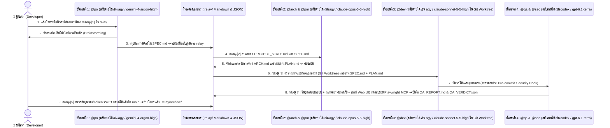

# สถาปัตยกรรมและหลักการทำงานเชิงลึกของระบบ `RELAY` (Architecture Deep Dive)

เอกสารฉบับนี้อธิบายหลักการทางวิศวกรรมซอฟต์แวร์เบื้องหลังการออกแบบระบบ **`RELAY`** ว่าเหตุใดการส่งมอบงานผ่านเอกสารกำหนดข้อตกลง (`.relay/`) ร่วมกับหน้าจอควบคุมกลางแบบนำทาง 3 ขั้นตอน (`Guided 3-Stage Progressive UX`) จึงช่วยแก้ไขปัญหาข้อจำกัดด้านหน่วยความจำบริบทของ AI (Context Window Degradation) ลดบริบทที่ต้องส่งซ้ำในแต่ละขั้น และใช้โควต้าแพ็กเกจรายเดือน (`Google AI Ultra`, `Claude`, `Codex`) ได้อย่างคุ้มค่าสูงสุด

---

## 1. ข้อจำกัดของการสั่งงาน AI แบบสนทนาต่อเนื่องยาวนาน (Single Long-Session Limitations)

การพัฒนาซอฟต์แวร์โดยใช้หน้าต่างสนทนาเดียวต่อเนื่องกันตั้งแต่การคิดโครงสร้าง การเขียนโค้ด ไปจนถึงการแก้ไขข้อผิดพลาด มักก่อให้เกิดปัญหาสำคัญ 3 ประการ:

1. **ความเสื่อมถอยของความแม่นยำเมื่อบริบทยาวเกินไป (Context Rot):**
   - เมื่อประวัติการสนทนาสะสมเกิน 30,000–50,000 คำ โมเดลภาษาขนาดใหญ่ (LLM) จะถูกรบกวนด้วยข้อมูลการลองผิดลองถูกในอดีต ส่งผลให้โค้ดที่สร้างขึ้นใหม่ขัดแย้งกับข้อกำหนดเริ่มต้น
2. **การสิ้นเปลืองโควตาการประมวลผลแบบสะสม (Cumulative Token Consumption):**
   - ในสถาปัตยกรรมของ LLM ทุกครั้งที่ผู้ใช้ส่งข้อความใหม่ 1 บรรทัด ระบบจำเป็นต้องส่งประวัติการสนทนาทั้งหมดตั้งแต่ต้นกลับไปประมวลผลซ้ำ ทำให้โควตาของแพ็กเกจรายเดือนถูกใช้งานจนหมดอย่างรวดเร็ว
3. **ความเสี่ยงด้านเงื่อนไขการใช้งานเมื่อรันอัตโนมัติ (Automated Execution & Terms of Service):**
   - การสร้างสคริปต์หรือเซิร์ฟเวอร์ที่ดัดแปลง CLI, ดึง token ออกไปใช้นอก CLI, หรือรันวนซ้ำแบบไม่มีขอบเขตบนบัญชีรายเดือนส่วนบุคคล อาจขัดต่อเงื่อนไขของผู้ให้บริการและเสี่ยงต่อการถูกระงับบัญชี
   - RELAY ลดความเสี่ยงนี้โดย: (1) เรียกเฉพาะ CLI ทางการผ่านโหมด non-interactive ที่แต่ละค่ายเปิดให้ใช้ (`agy -p`, `claude -p`, `codex exec`) ด้วยบัญชีของผู้ใช้เอง ไม่ดึงหรือแชร์ token (2) Auto-Loop มีขอบเขตชัดเจน — สูงสุด 3 รอบ, เพดานเวลาต่อขั้น, หยุดเมื่อโควต้าต่ำกว่า 20% (3) มนุษย์ต้องเริ่มลูปเองและเป็นผู้ผสานโค้ดเสมอ
   - อย่างไรก็ตาม เงื่อนไขของแต่ละแพ็กเกจเปลี่ยนแปลงได้ ผู้ใช้ควรตรวจสอบเงื่อนไขของแพ็กเกจที่ตนใช้ก่อนเปิดใช้ `[a]` Auto-Relay Loop

---

## 2. สถาปัตยกรรมของ `RELAY`: กระบวนการส่งมอบงาน 4 ขั้นตอนผ่านเอกสารสัญญา (4-Phase Artifact-Driven Workflow)

ระบบ `RELAY` แก้ไขปัญหาข้างต้นด้วยการแยกกระบวนการพัฒนาออกเป็น **4 ขั้นตอน (Phases)** ที่มีขอบเขตความรับผิดชอบชัดเจน และสื่อสารกันผ่านเอกสาร Markdown ขนาดกะทัดรัดในโฟลเดอร์ `.relay/`:

### กลไกหลักทั้ง 8 ส่วนของสถาปัตยกรรม `RELAY`:
1. **การสกัดบริบทสำคัญ เพดานความกระชับ และโหมดด่วน `Fast Track` (Context Distillation & Zero-Ceremony Fast Track):**
   - เมื่อสิ้นสุดการสนทนาในแต่ละขั้นตอน ข้อมูลที่ผ่านการกลั่นกรองแล้วจะถูกบันทึกเป็นเอกสารที่มีเพดานความยาวชัดเจน (`SPEC.md` ≤40 บรรทัด, `ARCH.md` & `PLAN.md` รวม ≤60 บรรทัด, `QA_REPORT.md` ≤30 บรรทัด) เพื่อลด Output Tokens ที่ไม่จำเป็น
   - ตัวแทน AI ในขั้นตอนถัดไปจะถูกเรียกขึ้นในเซสชันใหม่และอ่านเฉพาะเอกสารสรุปดังกล่าว ส่วนงานขนาดเล็กหรือการแก้บั๊กสามารถกด **`[x]` (`relay fast`)** เพื่อข้าม `@po` และ `@arch` แล้วส่ง `@dev` ทำงานใน Worktree ได้ทันที
   - ทุกขั้นตอนวัดผลจริงด้วยตัวเลขเวลา (`duration_sec`), จำนวน Token จริงจาก Session Logs ของ CLI (`input`, `cached`, `output`, `total`), และโควต้าก่อน–หลังใน `RUN_LOG.jsonl` (กด `[v]` หรือ `relay stats` เพื่อดูตารางเปรียบเทียบรายขั้นตอนและรายโมเดล)
2. **ระบบนำทาง 3 ขั้นตอนอัตโนมัติและการตรวจสอบความพร้อมจริง 3 ชั้น (`Guided 3-Stage UX & 3-Layer Verification`):**
   - **ชั้นที่ 1 (Binary Discovery):** ตรวจหาไบนารีของ CLI ในเครื่อง (`~/.gemini/bin/agy` สำหรับ Google AI Ultra, `codex`, และ `claude`)
   - **ชั้นที่ 2 (Live Auth Verification):** ตรวจสอบสถานะการ Login จริงของแต่ละค่าย (`~/.gemini/jetski-standalone-oauth-token`, `claude auth status`, `codex login status`)
   - **ชั้นที่ 3 (Live Model Discovery):** ดึงรายชื่อโมเดลสดจาก CLI (`agy models`, `~/.codex/models_cache.json`, ไบนารี `claude`) เพื่อให้มั่นใจว่าโมเดลที่เลือกสามารถเรียกใช้งานได้จริง 100%
3. **การกระจายโควต้าอย่างคุ้มค่าพร้อมระบบติดตามโควต้าคงเหลือแบบเรียลไทม์ (`Real-Time Multi-Provider Quota Engine`):**
   - ในแพ็กเกจ **Google AI Ultra** ผู้ใช้มีโควต้าแยกเป็น 2 ก้อนอิสระ คือ **Gemini Models** และ **Claude & GPT Models**
   - หน้าจอ `relay` (และคำสั่ง `relay quota` หรือปุ่ม `[u]` / `/quota`) ดึงเปอร์เซ็นต์โควต้าคงเหลือจริงทั้งรอบ **5 ชั่วโมง (5-Hour)** และ **รายสัปดาห์ (Weekly 7-Day)** พร้อมเวลาที่รีเซ็ตจากทั้ง `agy -p "/usage"`, `~/.codex/sessions`, และ Control Protocol `get_usage` ของ `claude` มาแสดงแบบเรียลไทม์ พร้อมแจ้งเตือนสีส้ม/แดง (`▲ ใกล้หมด`) ทันทีเมื่อค่ายใดมีโควต้าต่ำกว่า `20%`
   - การผูก `@po` เข้ากับ `agy (gemini-4-argon-high)` และผูก `@arch` / `@dev` เข้ากับ `agy (claude-opus-5-5-high / claude-sonnet-5-5-high)` ร่วมกับ `@qa` บน `codex (gpt-6.1-terra)` ช่วยกระจายภาระโควต้าไม่ให้ก้อนใดก้อนหนึ่งหมดก่อนเวลา
4. **การแยกสภาพแวดล้อมการพัฒนาด้วย `Git Worktree` (Isolated Development Environment):**
   - ในขั้นตอนที่ 3 (`@dev`) การแก้ไขโค้ดจะดำเนินการภายในกิ่งแยก (`.relay/worktrees/<task-id>`) เสมอ ช่วยป้องกันไม่ให้โค้ดในกิ่งหลัก (`main`) ได้รับผลกระทบระหว่างการพัฒนา
5. **การแยกแยะงานที่รันด้วยสคริปต์ระบบ (ไม่เรียก AI) กับการตรวจสอบโดย `@qa` และการจัดการ `PROJECT_STATE.md`:**
   - กลไกป้องกันไฟล์ความลับด้วย `pre-commit` Git Hook และการตรวจสอบสถานะกิ่งก่อนผสานในขั้นตอนที่ 5 ทำงานด้วยสคริปต์ของระบบปฏิบัติการโดยตรงโดยไม่เรียก AI (ไม่เสียโควตา Token)
   - ส่วนการสั่งให้ `@qa` รันชุดทดสอบหรือเปิด Playwright MCP จะใช้โควต้าแพ็กเกจรายเดือนตามความยาวของ Output จริง ระบบจึงกำชับให้เรียกใช้ Playwright เฉพาะเมื่อใบงานมีการแก้ไข Web UI และสรุปรายงานไม่เกิน 30 บรรทัด
   - เมื่อใบงานใดถูกผสานเข้าสู่กิ่ง `main` แล้ว จะถูกย้ายไปเก็บใน `.relay/archive/` ทันที และอัปเดตเฉพาะโครงสร้างล่าสุดของระบบไว้ใน `.relay/PROJECT_STATE.md` (ความยาวไม่เกิน 2 หน้า)
6. **วงรอบอัตโนมัติที่มีมนุษย์คุมหัว-ท้ายและเบรกนิรภัย (`Bounded Auto-Relay Loop` — `[a]` / `/loop`):**
   - ผสานแนวคิด **Loop Engineering** เข้ากับโครงสร้างของ `RELAY` โดยให้มนุษย์เป็นผู้ควบคุม **ขั้นตอนที่ 1 (`@po` สร้าง `SPEC.md`)** และ **ขั้นตอนที่ 5 (`Merge & Archive`)** ขณะที่ขั้นตอนที่ **`2 (@arch) ➔ 3 (@dev) ⇄ 4 (@qa)`** สามารถรันต่อกันแบบอัตโนมัติภายใต้เบรกนิรภัย 4 ชั้น:
     1. **Quota Circuit Breaker (`>= 20%`):** ตรวจสอบโควต้าคงเหลือจริงทั้ง `5h` และ `7d` ก่อนเริ่มทุกขั้นตอน (ถ้าเลยเวลารีเซ็ตแล้วนับเป็น 100%)
     2. **Max Remediation Cap (`3 รอบ`):** จำกัดการวนแก้บั๊ก `@dev ⇄ @qa` พร้อมบันทึก `LOOP_LOG.md` และเก็บรายงานรอบก่อนเป็น `QA_REPORT.before-round-N.md` เพื่อไม่ให้รายงานเก่าถูกนับซ้ำ
     3. **Cross-Provider Verification:** ตัดสินจาก `QA_VERDICT.json` แบบมีโครงสร้างก่อน (`PASS` ต้องไม่มี `failed_criteria`, JSON เสียรูปแบบ = ไม่ผ่าน) และใช้ `VERDICT:` ใน `QA_REPORT.md` เป็นทางสำรองเท่านั้น
     4. **Step Guard:** หยุดเมื่อ agent คืน error, ไม่สร้างไฟล์ผลลัพธ์, หรือเกินเพดานเวลาต่อขั้น (watchdog แบบ bash ล้วน ค่าเริ่มต้น 30 นาที ปรับด้วย `RELAY_STEP_TIMEOUT`)
   - Worktree ถูกสร้างผ่าน `prepare_task_worktree` ตัวเดียวกับขั้นตอนที่ 3 — ถ้าสร้างไม่ได้จะหยุดพร้อมข้อความ error จริง (ไม่ตกไปทำงานบนกิ่งหลัก) และเพิ่ม `.relay/worktrees/` ใน `.gitignore` อัตโนมัติ
   - โหมดสิทธิ์: `agy --mode auto`, `claude --permission-mode acceptEdits`, `codex exec --full-auto` (ไม่ใช้โหมดข้ามสิทธิ์ทั้งหมด)
7. **การผสานโค้ดที่ไม่ทำให้งานหาย (ขั้นตอนที่ 5):**
   - ตรวจ commit ใหม่, ไฟล์ค้างใน Worktree (ไม่นับ `.relay/`) และผลตรวจรับ ➔ เสนอ commit อัตโนมัติ ➔ ขอยืนยันเพิ่มถ้ายังไม่ผ่าน QA ➔ `git merge --no-ff` ➔ ถ้าล้มเหลวจะ `git merge --abort` และไม่ลบอะไร ➔ บันทึกใบงานลง `PROJECT_STATE.md` ➔ ลบ Worktree/กิ่งและ archive เฉพาะหลังผสานสำเร็จ
   - `PROJECT_STATE.md` ของกิ่งหลักถูกแก้เฉพาะหลังผสานสำเร็จ (agent ใน Worktree อ่านได้แต่ห้ามแก้) เพื่อไม่ให้เอกสารบรรยายโค้ดที่ยังไม่ได้ผสาน
   - ทุกการเรียก agent ถูกบันทึกลง `.relay/tasks/<task>/RUN_LOG.jsonl` (ขั้น, ค่าย, โมเดล, เวลา, exit code, โควต้าก่อน–หลัง)
8. **ระบบสกัดบทเรียนและสร้างทักษะเฉพาะโปรเจกต์อัตโนมัติ (`Self-Learning Project Skills` — `[l]` / `/learn`):**
   - ประยุกต์สถาปัตยกรรมจาก `tigerless-labs/autoharness` มาใช้ในระดับโปรเจกต์ เมื่อปิดใบงานที่ขั้นตอน `[5]` (หรือกด `[l]` / `relay learn`) ระบบจะสกัดกฎที่เสนอจาก `SPEC.md`, `ARCH.md`, และ `QA_REPORT.md` ลงคิว `.relay/skills/project-learned/PENDING.md` ก่อน — **กฎจะถูกส่งให้ AI เฉพาะเมื่อผู้ใช้อนุมัติใน `[l]` แล้วเท่านั้น** (ย้ายเข้า `SKILL.md`, ควบรวมไม่ให้ซ้ำ, ไม่เกิน 25 ข้อ) เพื่อป้องกันกฎผิดที่ AI เขียนเองถูกส่งต่อไปทุกใบงาน พร้อมสมุดบัญชี `.relay/skills/project-learned/LEDGER.md` โดยไม่แตะต้องไฟล์กฎส่วนกลาง `~/.agents/GLOBAL_AGENTS.md`
