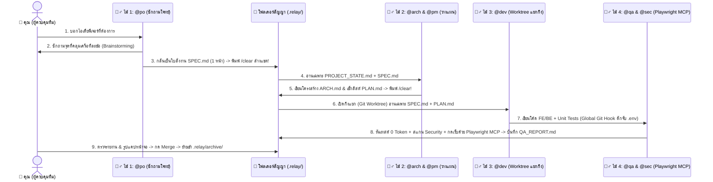

# 🏛️ เจาะลึกหลักการทำงานและสถาปัตยกรรมของ `RELAY` (Architecture Deep Dive)

เอกสารนี้อธิบายเหตุผลเบื้องหลังว่า **ทำไมระบบ `RELAY` ถึงถูกออกแบบมาให้ใช้ "เอกสารสัญญา (`.relay/`)" แทนการปล่อยให้ AI คุยกันเองในแชตยาวๆ** และทำไมสถาปัตยกรรมนี้ถึงช่วยให้ทีมพัฒนาทำงานได้เร็วขึ้น ประหยัดโควตา Token ลง 85–90% และไม่เสี่ยงโดนแบนบัญชีรายเดือน

---

## 1. ปัญหาใหญ่ของการใช้ AI แบบเดิม (ทำไมคุยแชตยาวถึงพัง?)

นักพัฒนาและผู้ใช้ส่วนใหญ่เมื่อเริ่มใช้ AI มักจะเปิดแชตเดียวแล้วสั่งงานต่อเนื่องไปเรื่อยๆ ตั้งแต่คิดไอเดีย เขียนโค้ด แก้บั๊ก ไปจนถึงเทสต์ระบบ ซึ่งทำให้เกิด **3 ปัญหาวิกฤต**:

1. **อาการสมองบวมและลืมคำสั่งแรก (Context Rot):**
   - เมื่อประวัติการคุยยาวเกิน 30,000–50,000 คำ AI จะเริ่มสับสนระหว่างสิ่งที่คุยกันตอนแรกกับโค้ดที่เพิ่งแก้ล่าสุด ทำให้แก้จุดหนึ่งแล้วไปทำอีกจุดหนึ่งพัง
2. **การเผาผลาญโควตา Token แบบทวีคูณ (Token Explosion):**
   - ทุกครั้งที่คุณพิมพ์ถามเพิ่ม 1 บรรทัดในแชตเดิม ระบบจะต้องส่งประวัติการคุยเก่าทั้งหมดกลับไปประมวลผลใหม่ทุกครั้ง ทำให้โควตารายเดือน (Pro/Max/Plus) เต็มภายในไม่กี่ชั่วโมง
3. **ความเสี่ยงโดนแบนบัญชีจากบอทอัตโนมัติ (Subscription Ban Risk):**
   - เครื่องมือบางตัวพยายามแก้ปัญหาด้วยการเขียนสคริปต์ครอบ CLI เพื่อยิงคำสั่งอัตโนมัติรัวๆ หลังบ้าน (Headless Loop) ซึ่งผิดเงื่อนไขการใช้งาน (ToS) ของผู้ให้บริการ AI และเสี่ยงถูกระงับบัญชีถาวร

---

## 2. ทางออกของ `RELAY`: ปรัชญา "การวิ่งผลัดส่งไม้ต่อ (Pass the Baton)"

แทนที่จะให้คนคนเดียววิ่งมาราธอนจนหมดแรง **`RELAY`** เปลี่ยนการทำงานเป็น **"การวิ่งผลัด 4×100 เมตร"**:

### หัวใจสำคัญ 4 ข้อที่ทำให้ `RELAY` เหนือกว่า:
1. **กลั่นความรู้ลงไฟล์สั้นๆ แล้วล้างแชตทิ้ง (`/clear`):**
   - เมื่อ `@po` คุยกับคุณจบ ความต้องการทั้งหมดจะถูกสรุปเหลือแค่ไฟล์ `SPEC.md` ความยาว 1 หน้ากระดาษ จากนั้นเราล้างแชตทิ้งทันที!
   - เมื่อ `@dev` มารับไม้ต่อ มันไม่ต้องอ่านบทสนทนาน้ำท่วมทุ่ง 50 หน้า มันอ่านแค่ `SPEC.md` และ `PLAN.md` ที่คมกริบ ทำให้สมองของ `@dev` สดใหม่ 100% และกิน Token น้อยลงถึง 90%!
2. **แยกห้องทดลองด้วย `Git Worktree` (โค้ดหลักไม่มีวันพัง):**
   - `@dev` จะทำงานในกิ่งแยก (ผ่าน `claude --worktree`, `vibe-kanban`, หรือ `claude-squad`) เสมอ หาก AI เขียนโค้ดผิดพลาด โค้ดในกิ่ง `main` ของคุณจะไม่ได้รับผลกระทบเลย
3. **ใช้สคริปต์ตรวจคำตอบด้วย 0 Token + ใช้ `Playwright MCP` เปิดเบราว์เซอร์ฟรี:**
   - การรัน Unit Test (`node --test`, `pnpm test`, `pytest`) และการดักจับไฟล์ `.env` ด้วย `pre-commit` hook ใช้สคริปต์ของเครื่องคอมพิวเตอร์ 100% จึงใช้ **0 Token**
   - ส่วนการเปิดหน้าเว็บกดปุ่มจริงและแคปหน้าจอ เราใช้ **[`microsoft/playwright-mcp`](https://github.com/microsoft/playwright-mcp)** ซึ่งเชื่อมต่อกับ CLI รายเดือนที่คุณมีอยู่แล้วได้ฟรี 100% โดยไม่ต้องจ่ายค่า API Key แยกเหมือนเครื่องมืออื่น
4. **ความยั่งยืนระยะยาวด้วย `PROJECT_STATE.md` และ `archive/`:**
   - แม้โปรเจกต์จะผ่านไป 1 ปีและมีใบงานสะสมกว่า 200 งาน AI ก็ยังทำงานเร็วเหมือนวันแรก เพราะใบงานเก่าที่ทำเสร็จแล้วจะถูกย้ายเข้า `.relay/archive/` และสรุปเฉพาะโครงสร้างล่าสุดของระบบไว้ใน `.relay/PROJECT_STATE.md` (ความยาวไม่เกิน 2 หน้า) เสมอ
