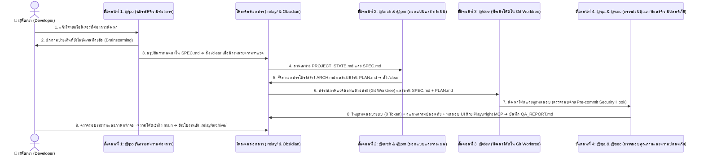

# สถาปัตยกรรมและหลักการทำงานเชิงลึกของระบบ `RELAY` (Architecture Deep Dive)

เอกสารฉบับนี้อธิบายหลักการทางวิศวกรรมซอฟต์แวร์เบื้องหลังการออกแบบระบบ **`RELAY`** ว่าเหตุใดการส่งมอบงานผ่านเอกสารกำหนดข้อตกลง (`.relay/`) จึงช่วยแก้ไขปัญหาข้อจำกัดด้านหน่วยความจำบริบทของ AI (Context Window Degradation) ลดอัตราการใช้ Token ลง 85–90% และรักษาความสอดคล้องกับเงื่อนไขการให้บริการ (Terms of Service) ของผู้ให้บริการ AI อย่างสมบูรณ์

---

## 1. ข้อจำกัดของการสั่งงาน AI แบบสนทนาต่อเนื่องยาวนาน (Single Long-Session Limitations)

การพัฒนาซอฟต์แวร์โดยใช้หน้าต่างสนทนาเดียวต่อเนื่องกันตั้งแต่การคิดโครงสร้าง การเขียนโค้ด ไปจนถึงการแก้ไขข้อผิดพลาด มักก่อให้เกิดปัญหาสำคัญ 3 ประการ:

1. **ความเสื่อมถอยของความแม่นยำเมื่อบริบทยาวเกินไป (Context Rot):**
   - เมื่อประวัติการสนทนาสะสมเกิน 30,000–50,000 คำ โมเดลภาษาขนาดใหญ่ (LLM) จะถูกรบกวนด้วยข้อมูลการลองผิดลองถูกในอดีต ส่งผลให้โค้ดที่สร้างขึ้นใหม่ขัดแย้งกับข้อกำหนดเริ่มต้น
2. **การสิ้นเปลืองโควตาการประมวลผลแบบสะสม (Cumulative Token Consumption):**
   - ในสถาปัตยกรรมของ LLM ทุกครั้งที่ผู้ใช้ส่งข้อความใหม่ 1 บรรทัด ระบบจำเป็นต้องส่งประวัติการสนทนาทั้งหมดตั้งแต่ต้นกลับไปประมวลผลซ้ำ ทำให้โควตาของแพ็กเกจรายเดือนถูกใช้งานจนหมดอย่างรวดเร็ว
3. **ความเสี่ยงด้านการระงับบัญชีจากการทำงานอัตโนมัติเบื้องหลัง (Automated Headless Execution Risk):**
   - การสร้างสคริปต์หรือเซิร์ฟเวอร์ครอบ CLI เพื่อสั่งรันคำสั่งอัตโนมัติแบบวนซ้ำ (Unattended Headless Loop) บนบัญชีสมาชิกรายเดือนส่วนบุคคล ขัดต่อข้อกำหนดการใช้งานของผู้ให้บริการ และมีความเสี่ยงสูงที่จะถูกระงับบัญชี

---

## 2. สถาปัตยกรรมของ `RELAY`: กระบวนการส่งมอบงาน 4 ขั้นตอนผ่านเอกสารสัญญา (4-Phase Artifact-Driven Workflow)

ระบบ `RELAY` แก้ไขปัญหาข้างต้นด้วยการแยกกระบวนการพัฒนาออกเป็น **4 ขั้นตอน (Phases)** ที่มีขอบเขตความรับผิดชอบชัดเจน และสื่อสารกันผ่านเอกสาร Markdown ขนาดกะทัดรัดในโฟลเดอร์ `.relay/`:

### กลไกหลักทั้ง 4 ส่วนของสถาปัตยกรรม `RELAY`:
1. **การสกัดบริบทสำคัญและการล้างหน่วยความจำ (Context Distillation & `/clear`):**
   - เมื่อสิ้นสุดการสนทนาในแต่ละขั้นตอน ข้อมูลที่ผ่านการกลั่นกรองแล้วจะถูกบันทึกเป็นเอกสารขนาด 1–2 หน้า (`SPEC.md`, `ARCH.md`, `PLAN.md`) จากนั้นผู้พัฒนาจะใช้คำสั่ง `/clear` เพื่อล้างประวัติการสนทนาทันที
   - ตัวแทน AI ในขั้นตอนถัดไปจะอ่านเฉพาะเอกสารสรุปดังกล่าว ทำให้ได้รับข้อมูลที่แม่นยำโดยไม่มีข้อความรบกวน และลดการใช้ Token ลงได้ถึง 85–90%
2. **การแยกสภาพแวดล้อมการพัฒนาด้วย `Git Worktree` (Isolated Development Environment):**
   - ในขั้นตอนที่ 3 (`@dev`) การแก้ไขโค้ดจะดำเนินการภายในกิ่งแยกหรือ `Git Worktree` เสมอ ช่วยป้องกันไม่ให้โค้ดในกิ่งหลัก (`main`) ได้รับผลกระทบระหว่างการพัฒนา และรองรับการพัฒนาหลายฟีเจอร์ควบคู่กัน
3. **การตรวจสอบคุณภาพด้วยสคริปต์ระบบ (0-Token Verification) ร่วมกับ `Playwright MCP`:**
   - การรันชุดทดสอบ (Unit / Integration Tests) และการตรวจสอบไฟล์ความลับด้วย `pre-commit` hook ทำงานด้วยสคริปต์ของระบบปฏิบัติการโดยตรง จึงไม่ใช้โควตา Token ของ AI
   - สำหรับการทดสอบส่วนติดต่อผู้ใช้บนเว็บ (Web UI) ระบบใช้ **[`microsoft/playwright-mcp`](https://github.com/microsoft/playwright-mcp)** ซึ่งทำหน้าที่เป็นเครื่องมือให้ CLI ที่คุณมีแพ็กเกจรายเดือนอยู่แล้วสามารถเปิดเบราว์เซอร์จำลองการคลิกและบันทึกภาพหน้าจอได้โดยไม่มีค่าใช้จ่าย API เพิ่มเติม
4. **การจัดการสถานะโครงการระยะยาวด้วย `PROJECT_STATE.md` และ `archive/`:**
   - เพื่อรองรับการใช้งานต่อเนื่องยาวนานหลายปีโดยไม่ทำให้โฟลเดอร์ใบงานสะสมจนรก เมื่อใบงานใดถูกผสานเข้าสู่กิ่ง `main` แล้ว จะถูกย้ายไปเก็บใน `.relay/archive/` ทันที และอัปเดตเฉพาะโครงสร้างล่าสุดของระบบไว้ใน `.relay/PROJECT_STATE.md` (ควบคุมความยาวไม่เกิน 2 หน้า)
